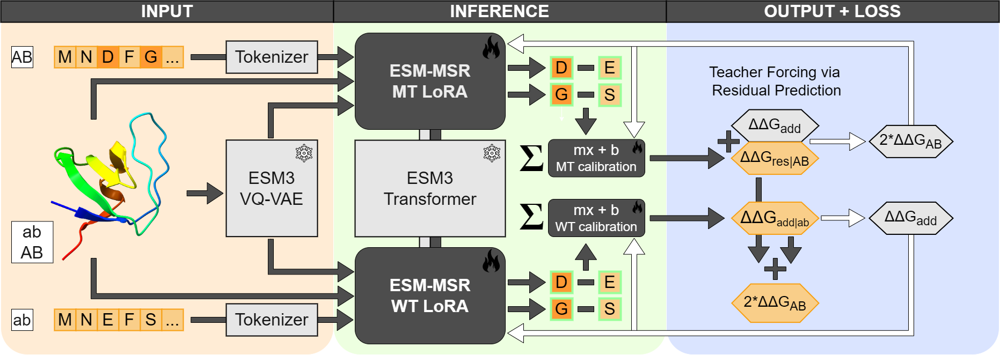
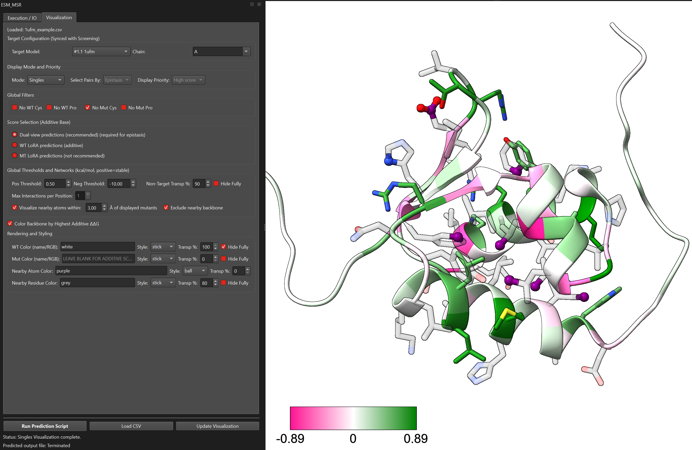

# ESM-MSR

This mutant stability predictor was created by parameter-efficient fine-tuning of ESM3-small-open (https://www.science.org/doi/10.1126/science.ads0018) on protease susceptibility assays from Tsuboyama et al. (https://www.nature.com/articles/s41586-023-06328-6). It generates state-of-the-art predictions on numerous benchmark datasets including S461 and PTMUL-D. This repository is designed to enable fast inference using this approach and facilitate reproducing results from our paper, currently in pre-print. We also created an interface for inference and visualization in ChimeraX. You can read the accompanying preprint here: https://www.biorxiv.org/content/10.64898/2026.06.04.730231v1.



## Requirements

Python 3.11-3.13 [Download Python](https://www.python.org/downloads/windows/)

CUDA 12.8 if using GPU-accelerated inference

NVIDIA GPU with 24+ GB VRAM for training, 8GB is likely sufficient for low batch size inference. Inference can also be done on a CPU (very slowly).

ChimeraX if intending to use the graphical user inference (GUI) and visualization tool: [Download ChimeraX](https://www.cgl.ucsf.edu/chimerax/download.html).

Tested extensively on Python 3.12, CUDA 12.8, ChimeraX 1.10.

Installation time: 10 minutes to clone repository and setup virtual environment. An additional 10 minutes is required to install ChimeraX and the ESM-MSR plugin. Downloading additional LoRAs from HuggingFace can be done concurrently.

## Demo Information

All steps below are required to complete the demo, except "Basic Usage - Command Line Interface (Skip if using ChimeraX GUI)". The end of the README, starting from "Using the ChimeraX GUI", is the demo; make sure to load the 1UFM structure if trying to check demo files (`open 1ufm`). The expected output is visually indicated at the end of the file (equivalent to Figure 6 in the manuscript). You can also compare your output CSV to the one saved at `data/example/1ufm_example.csv`.

## Recommended Installation

## Windows Set-up from Zero:

1. Download and install Python version 3.11-3.13: [Download Python](https://www.python.org/downloads/windows/). Be sure to check the "Add python.exe to PATH" box before clicking "Install Now".

2. Download the .zip version of this repository from the top left of this GitHub page (or clone it if you have installed Git for Windows).

3. Extract the repository where you would like the program to be installed.

4. Inside the esm-msr folder in File Explorer (you should see pyproject.toml), click on the address bar and type "cmd" to open a command prompt in the repository location.

5. Enter the following commands (you can cut and paste):

```
python -m venv msr_venv python=3.12
.\Scripts\activate.bat
pip install torch
pip install -e .
```

Your Python environment is now setup, but you still need to obtain the ESM3 base model and install the tool in ChimeraX to use the GUI. See below.

## Linux Command Line Setup with CUDA GPU acceleration:

Clone the repo, create a conda environment, and install in editable mode:

```
git clone https://github.com/SKTeamLab/esm-msr.git
cd esm-msr
conda create -n msr_venv python=3.12
conda activate msr_venv
pip install torch torchvision torchaudio --index-url https://download.pytorch.org/whl/cu128
pip install -e .
```

## Obtaining ESM3-small-open weights

Weights are available from [HuggingFace](https://huggingface.co/biohub/esm3-sm-open-v1).

From here you have two options:

1. Allow the environment package `esm` to handle the model download and possible updates. No action is required unless ESM/Biohub changes this access mechanism.
2. Alternatively: download all files in the `data/weights` HuggingFace repo to your machine. If you have git installed, the easiest way is to use `git clone https://huggingface.co/biohub/esm3-sm-open-v1`. You will need to enter this location into the CLI or GUI.

## Basic Usage - Command Line Interface (Skip if using ChimeraX GUI)

You should now have everything you need to make your first predictions from the command line, except for a pdb/mmcif structure of interest, which you should download if following this step.

We include a small version of our LoRA model in this repository for convenience (`LoRA_models/esm-msr-small`: three training seeds, `lora_seed1.safetensors` to `lora_seed3.safetensors`, with rank-2 adapters on both passes), which is used in the example below. If you want to use other models, please see our [HuggingFace page](https://huggingface.co/sareeves96/esm-msr), download the models to the LoRA_models folder, and change the path specified in the command.

Inference strategies, performance and compute time are discussed in the paper. The below command is a fast approximation of single mutant saturation mutagenesis that should take less than a minute even on a CPU, apart from loading the model weights which is very hardware dependent.

`python src/esm_msr/inference.py --checkpoint_path LoRA_models/esm-msr-small/lora_seed1.safetensors --pdb_file path_to_your_structure_file --mode singles --skip_reverse --output_csv ./example_output.csv`

Or, if you want to directly use a PDB structure:

`python src/esm_msr/inference.py --checkpoint_path LoRA_models/esm-msr-small/lora_seed1.safetensors --code 1A0F --chain A --mode singles --skip_reverse --output_csv ./example_1A0F.csv`

Remove the `--skip_reverse` flag for a much slower, slightly higher accuracy screen (proportional to total possible mutations). Change the screening `--mode` to `singles+doubles` to screen all double and single mutants (the singles are comparatively almost free and useful for visualization later). It is not recommended to use `--skip_reverse` for `--mode doubles` because this ignores epistasis. A full double mutant screen on a protein greater than 200 residues is very compute expensive. It is therefore recommended to screen only double mutants where the wild-type residues are within 6 Angstrom heavy atom distance. This is controlled with the `--distance_threshold` parameter. Multi-mutants must be screened individually, either by generating an `--input_csv` with columns `pdb_file, code, chain, mut_type` and mutations (`mut_type`) specified like A2C:D3E, or individually passing in comma separated mutations via `--mutations`. An example can be seen in `data/preprocessed/ptmul_mapped.csv`; extra columns are allowed.

The visualizer generates predictions using this script. You can read the GUI section to understand how `inference.py` can be used from the command line.

## Reproducing Benchmarks

If you want to reproduce the benchmarks without running preprocessing, you can download the relevant data from Zenodo (https://doi.org/10.5281/zenodo.21539277; `preprocessed_data.tar.gz`), place the contents in the data folder, and then run this command:

`python inference_scripts/esm_msr_testing.py --checkpoint esm-msr-small/lora_seed1.safetensors --split splits_oct06_capped --local_path_to_structures path_to_structures_from_zenodo`

Note that the model selected here is included in the repo due to its small size and will have very similar performance to the one used in the paper, but the exact model(s) must be downloaded from HuggingFace and the `--checkpoint` argument must be updated accordingly. Benchmarking will take at least an hour even on a powerful GPU.

## ProteinGym Benchmarking

ESM-MSR can be scored against the full [ProteinGym](https://proteingym.org/) deep mutational scanning (DMS) benchmark (v1.3 release: 217 DMS, over 2.4 million mutants, [Zenodo 15293562](https://zenodo.org/records/15293562)). Two scripts are involved: `preprocessing/pgym_preprocess.py` (one-time setup per machine) and the `--protein_gym` mode of `inference_scripts/esm_msr_testing.py` (the actual scoring, which is resumable).

### 1. Download the official ProteinGym data (~62 MB)

`wget https://zenodo.org/records/15293562/files/DMS_substitutions.csv`
`wget https://zenodo.org/records/15293562/files/DMS_ProteinGym_substitutions.zip`
`wget https://zenodo.org/records/15293562/files/ProteinGym_AF2_structures.zip`

`mkdir -p ProteinGym && mv DMS_substitutions.csv ProteinGym/`
`unzip DMS_ProteinGym_substitutions.zip -d ProteinGym`
`unzip ProteinGym_AF2_structures.zip -d ProteinGym`

Each zip extracts to a folder of the same name, so you should end up with 217 per-DMS CSVs under `ProteinGym/DMS_ProteinGym_substitutions/` and 199 AlphaFold2 structures under `ProteinGym/ProteinGym_AF2_structures/` (one PDB per protein, shared by the DMS on that protein).

### 2. Preprocess (one-time, a few minutes)

`python preprocessing/pgym_preprocess.py --proteingym_dir ProteinGym --out pgym_inputs`

This aligns each DMS's mutations to the corresponding AlphaFold2 structure (re-numbering positions when the DMS and structure use different numbering schemes) and writes one ready-to-score CSV per DMS plus a `manifest.csv` into `pgym_inputs/`. On the official release you should see `Runnable DMS: 217`, `Total mapped: 2465767`, `Skipped DMS: 0`, and `unmapped total: 0`. A nonzero `wt_mismatch` count (57 on the official release) is expected and harmless. Note that `pgym_inputs/` is machine-specific: the manifest records the absolute path to your `ProteinGym` folder, so if you move the data (or copy `pgym_inputs` to another machine), just re-run the preprocessor.

### 3. Run the benchmark (resumable, ~1 day on a 32 GB GPU)

`python inference_scripts/esm_msr_testing.py --checkpoint esm-msr/lora_seed1.safetensors --protein_gym --pgym_dir pgym_inputs --pgym_out pgym_results --auto_batch_size --dtype bf16 --sigma 1.0`

* `--checkpoint` is relative to the `LoRA_models/` folder. The full model above is not included in the repo (only the small demo model is); download it once from our [HuggingFace page](https://huggingface.co/sareeves96/esm-msr): `huggingface-cli download sareeves96/esm-msr --local-dir LoRA_models/esm-msr`.
* `--auto_batch_size` sizes each batch from measured GPU memory, so no manual tuning is needed. If a DMS simply does not fit in GPU memory even at batch size 1, it is logged as a failure and the run continues with the next DMS (on WSL2, very large DMS may instead spill into system RAM and complete very slowly).
* `--dtype bf16` is required for accuracy and speed on modern GPUs.
* `--sigma 1.0` runs the trained ESM-MSR model; set it to `0.0` to score with the untrained (zero-shot) ESM3 backbone as a control.
* `--skip_reverse` scores with the WT pass only (the additive approximation): each DMS runs a single cached WT-context forward, and every mutant is then scored by gathering the per-position local-substitution log-likelihood ratios from it. No mutant-context forward is run, so `mt_lora_pred`/`combined_pred` are NaN (omitted from the CSVs) and the per-DMS correlation is computed on `wt_lora_pred` instead. It is ~10× faster than the full two-pass mode (~17 min vs ~1 day for all 217 DMS on a 32 GB card), and the batch size no longer affects VRAM, since the one forward is always run at batch size 1.
* The run is resumable: any DMS that already has an output CSV in `--pgym_out` is skipped, so you can interrupt and restart freely. Use `--pgym_dms DMS1,DMS2` to score only a subset (defaults to all).
* Outputs: one CSV per DMS with the predictions (`combined_pred`) alongside the experimental `DMS_score`, plus a `summary.csv` with the per-DMS Spearman correlation (`spearman_combined`), timing, and status. A DMS that crashes mid-run is recorded in `summary.csv` with `status=fail` and an error message; fix the cause (usually memory) and re-run — only that DMS will be re-attempted.

### Reference run and expected results

These reference numbers were measured with the previous release of the adapters, which is kept on the [`archive-2026-11`](https://huggingface.co/sareeves96/esm-msr/tree/archive-2026-11) branch of the HuggingFace repository (the current `main` holds the final-recipe triplicate, and `esm-msr-small` in this repository was replaced the same way); they will be refreshed for the current models. Our reference runs score **all 217 of 217 DMS** on a single RTX 5090 (32 GB): the full model at σ=1.0 for all three training seeds (`esm-msr/lora_seed1.safetensors`, `lora_seed2.safetensors`, `lora_seed3.safetensors`) — each also scored in WT-only mode (`--skip_reverse`, the additive approximation, scored on `wt_lora_pred`) — and the small demo model (`esm-msr-small/epoch=03-...ckpt`) at σ=1.0, 0.5, and 0.0 (zero-shot ESM3 control), and the legacy chain model (`esm-msr-chain/epoch=04-...ckpt`) at σ=1.0:

| Model | σ | mean Spearman | median | DMS positive | best DMS (ρ) | worst DMS (ρ) |
|---|---|---|---|---|---|---|
| esm-msr seed1 | 1.0 | **0.555** | 0.497 | 215 / 2 | `NUSA_ECOLI_Tsuboyama_2023_1WCL` (0.972) | `TADBP_HUMAN_Bolognesi_2019` (−0.259) |
| esm-msr seed2 | 1.0 | 0.560 | 0.505 | 215 / 2 | `NUSA_ECOLI_Tsuboyama_2023_1WCL` (0.979) | `TADBP_HUMAN_Bolognesi_2019` (−0.254) |
| esm-msr seed3 | 1.0 | 0.554 | 0.501 | 215 / 2 | `NUSA_ECOLI_Tsuboyama_2023_1WCL` (0.970) | `TADBP_HUMAN_Bolognesi_2019` (−0.239) |
| esm-msr seed1, WT-only | 1.0 | 0.550 | 0.509 | 215 / 2 | `NUSA_ECOLI_Tsuboyama_2023_1WCL` (0.950) | `TADBP_HUMAN_Bolognesi_2019` (−0.276) |
| esm-msr seed2, WT-only | 1.0 | 0.553 | 0.507 | 215 / 2 | `NUSA_ECOLI_Tsuboyama_2023_1WCL` (0.958) | `TADBP_HUMAN_Bolognesi_2019` (−0.244) |
| esm-msr seed3, WT-only | 1.0 | 0.550 | 0.514 | 215 / 2 | `NUSA_ECOLI_Tsuboyama_2023_1WCL` (0.953) | `TADBP_HUMAN_Bolognesi_2019` (−0.244) |
| esm-msr-small | 1.0 | 0.552 | 0.496 | 214 / 3 | `NUSA_ECOLI_Tsuboyama_2023_1WCL` (0.971) | `TADBP_HUMAN_Bolognesi_2019` (−0.262) |
| esm-msr-small | 0.5 | 0.542 | 0.517 | 216 / 1 | `NUSA_ECOLI_Tsuboyama_2023_1WCL` (0.923) | `TADBP_HUMAN_Bolognesi_2019` (−0.031) |
| esm-msr-small | 0.0 | 0.457 | 0.465 | 216 / 1 | `PR40A_HUMAN_Tsuboyama_2023_1UZC` (0.849) | `SYUA_HUMAN_Newberry_2020` (−0.014) |
| esm-msr-chain | 1.0 | 0.556 | 0.518 | 215 / 2 | `NUSA_ECOLI_Tsuboyama_2023_1WCL` (0.974) | `B2L11_HUMAN_Dutta_2010_binding-Mcl-1` (−0.125) |

Four of the 217 are size extremes that need special handling on a 32 GB card: `BRCA2_HUMAN_Erwood_2022_HEK293T` (2,832 residues) saturates the GPU at batch size 1 and completes via CPU spill into system RAM (~13 min; needs ~54 GB of free RAM and PyTorch's default allocator), `SCN5A_HUMAN_Glazer_2019` (2,016 residues), `POLG_CXB3N_Mattenberger_2021` (2,185) and `BRCA1_HUMAN_Findlay_2018` (1,863) also need the default allocator (they fit on-card). If any of them fails on a first attempt, retry just that DMS with `PYTORCH_CUDA_ALLOC_CONF=` (empty) set in the environment. On a 32 GB card in bf16, the maximum structure length that fits on-card scales from ~1,740 residues at batch 1 to ~500 at batch 12 and ~215 at batch 64.

### Baselines on the same inputs

`inference_scripts/thermompnnd_testing.py` takes the same `--protein_gym --pgym_dir pgym_inputs --pgym_out DIR [--pgym_dms ...]` flags as `esm_msr_testing.py`; ProteinMPNN, SPURS, ThermoMPNN-D (retrained) and MutateEverything have their own run-everything scripts in `inference_scripts/baselines/` (see its README; ProteinGym is one of their blocks, `--pgym_dir`/`--pgym_dms`). All of them run ProteinGym through one shared loop (`inference_scripts/pgym_runner.py`), so the baselines' per-DMS CSVs, `summary.csv` and resume rule are the same as ESM-MSR's. Every readout is signed so that higher means fitter. `summary.csv` reports `spearman_combined` for the headline column and `spearman_<col>` for each secondary readout:

* **ProteinMPNN** (`v_48_020`, unmasked; set `PROTEINMPNN_DIR` to your ProteinMPNN checkout).
  * Headline `mpnn_score`: the mean of the log-odds with the wild-type and with the variant sequence as context, each mutated position decoded last.
  * `mpnn_score_wt_seq`: wild-type context only.
  * The encoder runs once per structure, and each distinct (position, other mutations) context is decoded once. All 217 DMS take about 2 h on a 24 GB GPU.
* **SPURS** (the public HuggingFace weights by default).
  * Headline `SPURS_multi`.
  * Also `SPURS_single_additive` and `SPURS_multi_additive`.
* **ThermoMPNN-D** (`--single_checkpoint`, `--epistatic_checkpoint`; set `THERMOMPNN_DIR`).
  * Headline `pred_combined`: the epistatic model on double mutants, the single-mutant model's additive sum otherwise.
  * Also `pred_single_additive`.

## Adding the Visualizer to ChimeraX

*Note: if using Windows Subsystem for Linux (WSL), it is recommended to install ChimeraX on Windows, not WSL. Everything should work even if you installed ESM-MSR into WSL.*

The **ChimeraX-ESM-MSR** plugin (**v0.5.0**) supports UCSF ChimeraX `>= 1.3` (verified on ChimeraX `1.11.1` / Python 3.11 / PyQt6 / pandas 2.x & 3.x) and provides live ESM-MSR inference, two-stage fast double-mutant discovery, publication-grade 3D/2D visualization, and native ChimeraX CLI commands. For full installation options, complete UI & CLI reference, standalone `fast_doubles.py` usage, CSV schema, troubleshooting, and headless testing instructions, see **[`ChimeraX-ESM_MSR/README.md`](ChimeraX-ESM_MSR/README.md)**.

1. Download, install, and open [ChimeraX](https://www.cgl.ucsf.edu/chimerax/download.html) (free for non-commercial use).
2. Open the Command Line Interface (`Tools -> Command Line Interface` if not already visible).
3. Run (replacing `/path/to/repo` with your local `esm-msr` checkout):
   ```
   devel install /path/to/repo/ChimeraX-ESM_MSR
   ```

## Using the ChimeraX GUI & Native CLI

Load a valid protein structure (PDB or mmCIF) into ChimeraX — for example, click and drag a structure file into the window or run `open 1ufm` for the demo. Launch the plugin from **`Tools -> Stability -> ESM_MSR`** (or run `esm_msr open`; window title: **ESM-MSR Predictor & Visualizer**).

The interface is organized into two scrollable tabs — **`Execution / IO`** and **`Visualization`** — above a shared global action bar (**`Run Prediction Script`** / **`STOP`**, **`Load CSV`**, **`Load Last Output`**, **`Update Visualization`**, and **`Reset / Clear Viz`**) with a live progress bar and status footer. Your paths and configuration settings are remembered automatically between sessions.

### 1. Execution / IO (Environment, Models & Screening Config)

* **Local Path Configuration & Auto-Detection:** Set **`Base Repo Dir:`** to your cloned `esm-msr` folder (auto-populating **`Output CSV:`** and the default **`Checkpoint:`** `LoRA_models/esm-msr-small/lora_seed1.safetensors` if blank). Click **`Auto-Detect`** next to **`Python Env:`** to scan local conda/mamba/venv environments on disk (~25 ms) and prioritize `[esm_msr, esm, torch]` installs via the **`Detected:`** dropdown, or enter an environment path/name manually. Optionally set **`ESM3 Weights:`** for locally cloned weights.
* **Compute Environment & Model Configuration Files:** Select **`Compute Device:`** (`cuda`, `cuda:0`, `cuda:1`, `mps`, `cpu`), **`Model Precision (dtype):`** (`float32`, `bfloat16`, `float16`), and **`Batch Size:`** (default `16`). Choose a LoRA **`Checkpoint:`** (`.safetensors` or `.ckpt`) and optional **`LoRA Config:`** (`hparams.yaml` is auto-detected beside the checkpoint; set **`Sigma (σ):`** `= 0.0` for zero-shot ESM3 backbone control).
* **Screening Config:** Pick your **`Target Model:`** (use **`Refresh`** if needed) and **`Chain:`**, then choose one of four mutually exclusive mutation scopes:
  1. **`1. Full Screen:`** (`singles` or `singles+doubles`), with optional **`Positions:`** (supports negative indices and insertion codes, or populate from ChimeraX via **`Grab Selection`**), **`Invert (Except)`**, and **`Filter doubles by WT heavy-atom distance (Å):`** (default `6.0` Å).
  2. **`2. Input CSV:`** score a predefined mutation list (`--input_csv`).
  3. **`3. Direct Mutations:`** enter comma-separated mutations directly (e.g., `A12C,A12C:D15E`).
  4. **`4. Fast Top-N Doubles (2-Stage):`** runs a fast cached WT-pass singles scan, selects the exact Top-$N$ additive pairs (`1–1,000,000` in `< 1 s`), rescores them with the full dual-view WT+MT model, and writes a unified re-ranked CSV (`Top N`, `Visualize Top M`, `Filter Cys/Pro before Stage 2`, optional `Dist <=`). Also runnable standalone via `ChimeraX-ESM_MSR/src/fast_doubles.py`.
* **Screening Parameters & Log Console:** Configure **`Mask Strategy:`** (`Checkpoint default`, `marginal`, `independent`), **`Sigma (σ):`** (default `1.0`), **`Replace non-canonical residues`**, and **`Skip MT LoRA Pass (Additive Approximation)`** (`--skip_reverse`, ~10× faster single-pass WT approximation). Expand **`▸ Show Log Console`** to inspect or copy live subprocess output. Click **`Run Prediction Script`** (or red **`STOP`** to terminate safely), then **`Load Last Output`** to jump straight to visualization.

### 2. Visualization, Export & Native CLI Commands

Load an existing prediction CSV with **`Load CSV`** (e.g., `data/example/1ufm_example.csv`) or **`Load Last Output`**. The top banner summarizes the loaded file, chain(s), mutation counts, and score range, and automatically handles `--skip_reverse` and unified two-stage CSVs.

* **Display Modes (`Mode:`):**
  * **`Singles`:** Displays the top passing single mutant per position on a cloned mutant model.
  * **`WT epistasis`:** Maps Alanine/Glycine double-mutant epistasis directly onto native WT sidechains.
  * **`MT epistasis`:** Displays double-mutant pairs across minimal non-conflicting clone layers with epistasis pseudobonds.
  * **`Top-M Ranked Pairs`:** Highlights Top-$M$ double-mutant pairs (including distant/non-proximal hits) using **Okabe–Ito categorical pair coloring** on a neutral matte cartoon, with **`Disjoint residues`** deduplication, optional subtle dashed connectors, 3D labels, stacked 2D legend, and **`Pub Lighting`**.
* **Color Scale & Export:** Choose from 5 verified zero-network palettes (**`Blue–White–Red (Classic)`** default, colorblind-safe **`Purple–White–Green (PRGn)`**, **`Brown–White–Teal (BrBG)`**, **`Cividis`**, and **`Viridis`**) with **`Auto Range`** or manual **`Min:`** / **`Max:`** bounds. Export publication-ready figures directly via **`Export 2D Heatmap...`** (20 × $L$ single-mutant landscape, PNG/PDF/SVG) and **`Export Pair Card...`** (Top-$M$ categorical legend card).
* **Interactive Ranked Results Table:** Filter by mutation/residue (`Filter mutation / residue...`), switch **`View:`** (`Auto`, `Ranked Pairs`, `All Singles`, `All Doubles`), sort numerically, click any row to select and focus the camera on those residues, and use **`Isolate Pair`** / **`Show All`** to spotlight individual Top-$M$ pairs.
* **Filters, Thresholds & Styling:** Exclude Cys/Pro (`No WT/Mut Cys/Pro`), select score base (`Dual-view`, `WT LoRA`, `MT LoRA`), set **`Pos Threshold:`** / **`Neg Threshold:`**, **`Non-Target Chain Transp %:`**, **`Color Backbone by Highest Additive ΔΔG`**, **`Nearby atoms within:`**, and per-element styling (**`WT:`**, **`Mutant:`**, **`Near Atom:`**, **`Near Res:`**). **`Reset / Clear Viz`** removes ESM-MSR clones, dedicated pseudobond groups (`"ESM-MSR Epistasis"`, `"ESM-MSR Ranked Pairs"`), and 2D legend labels without touching unrelated models or user pseudobonds.
* **Native ChimeraX CLI Commands:** Script reproducible GUI or `--offscreen` `.cxc` figures using `esm_msr open`, `esm_msr load`, `esm_msr visualize`, `esm_msr pairs`, `esm_msr heatmap`, and `esm_msr reset`.

#### Color Mapping Guide
* **Continuous Stability / Epistasis Modes (`Singles`, `WT epistasis`, `MT epistasis`):** Colored by the selected **`Palette:`** (default `Blue–White–Red`: **Red** = stabilizing/synergistic `> 0`, **White** = neutral `0`, **Blue** = destabilizing/antagonistic `< 0`; colorblind-safe `PRGn`, `BrBG`, `Viridis`, and `Cividis` also included).
* **Categorical Pair Mode (`Top-M Ranked Pairs`):** Each ranked pair (`#1`–`#12`) receives a distinct high-contrast **Okabe–Ito / Tol** hue matched across its mutated sidechains, backbone anchor segments, optional Cα–Cα connector, 3D labels, and on-canvas 2D legend.

See **[`ChimeraX-ESM_MSR/README.md`](ChimeraX-ESM_MSR/README.md)** for the full UI & CLI reference, reproducible `.cxc` script example, standalone `fast_doubles.py` documentation, CSV schema, and troubleshooting guide.

### Expected Output

An example is shown below after loading `data/example/1ufm_example.csv` onto `1ufm` (`open 1ufm`), corresponding to a default single-mutant screen. Expected runtime is ~1 minute for inference on an NVIDIA GPU at batch size 16 (or ~5 minutes on CPU), plus up to two minutes to render visual elements in ChimeraX. Note that because the example uses the small demo model and a crystal structure rather than a predicted structure, the selected mutations differ slightly from those in the paper.


