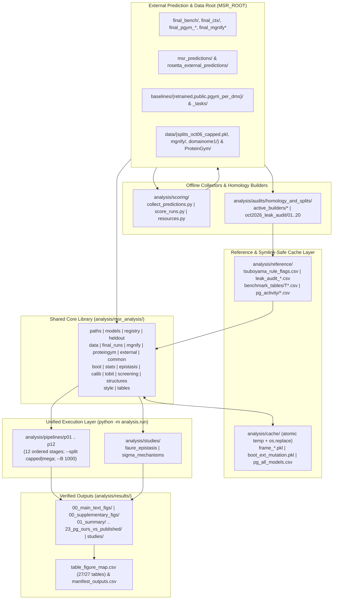

# Analysis Architecture, Bug Fixes, and Scientific Findings (`analysis/docs/ARCHITECTURE_AND_FINDINGS.md`)

## 1. End-to-End Data-Flow Architecture

The `analysis/` package transforms raw per-variant model predictions (`<MSR_ROOT>/`) and split/homology inventories into verified publication figures, statistical tables, and reproducibility manifests without requiring GPU access at analysis time.

### Architectural Invariants Enforced by the Refactor

1. **Zero cross-script `importlib` or `sys.path` hacks**: Previously, 12 top-level scripts dynamically imported sibling scripts via `importlib.util.spec_from_file_location` (`11k -> 11 + 11l + 11h`, `01_summary -> proteingym/p0_sigma/03`, `23 -> pg_activity/02`, `16/17 -> 08`, `13 -> 12`, `20 -> preprocessing/split_overlap_report`). All shared data loaders, statistical routines, structure parsers, and plotting primitives now live in `analysis/msr_analysis/`.
2. **Immutable model & style registry (`StyleSpec` + `MappingProxyType`)**: `msr_analysis/models.py` and `registry.py` expose read-only style mappings covering every `.single`, `.multi`, `.add`, `.epi`, display-name, and `FINAL_*` ablation key (`ABLATION_STYLES`). Plot-local label annotations pass `style_overrides` rather than mutating global dicts in place.
3. **Explicit split parameterization (`--split capped|mega`)**: Split-aware stages (`p02`, `p06`, `p07`, `p09`) pass `split` explicitly through `registry.tsu_datasets(split)` and `paths.results_dir(name, split)`, eliminating import-time `os.environ['MSR_TSU_SPLIT']` state mutation.
4. **Symlink-safe atomic caching**: Every cache and CSV writer (`paths.atomic_pickle_dump`, `paths.atomic_to_csv`, `paths.atomic_write_text`) writes to `tempfile.NamedTemporaryFile(dir=target.parent)` followed by `os.replace()`, ensuring worktree symlinks in `analysis/cache/` are atomically replaced rather than written through, and recording `(mtime_ns, size)` source signatures (`check_sources=True`) to guard against stale caches.

---

## 2. Methodological & Software Bugs Fixed During Refactoring

| # | Bug / Discrepancy in Pre-Refactor Code | Impact on Numbers / Execution | Fix in Refactored Codebase |
| :---: | :--- | :--- | :--- |
| **1** | **Silent WT-head substitution & unresampled seed noise in `98_final_ablation_table.py`** (`pg\|avg` omitted from `MULTI_COLS`; `pg_boot` averaged seeds before resampling) | `table_main_delta` ("deployed readout") reported **WT-only** `pg\|avg` (`0.50904`, disagreeing with Fig 3b's `0.5089`) and scored MT-only ablations (`r2a4`, `p1_marg`, `pw0`) on their untouched WT heads with `se_boot = 0.00020`, falsely bolding `-0.001` WT seed drift as significant! | `p11_ablations_and_heads.py` evaluates true deployed `wt+comb` on `table_main_delta` for families with complete `final_pgym_comb` runs (`FINAL_p0`, `FINAL_p1`), marks unrun multi-mutant `comb` cells `—`, keeps WT-only comparisons in `table_wt_delta`, and uses joint `[category-assay × 3-seed]` bootstrap (`B >= 1000`). |
| **2** | **`boot.py` hardcoded 3-seed multinomial (`11.1% NaN` on 2-seed models) & broken `kind='site'` on `PER_PROTEIN`** | 2-seed models (`FINAL_p1:comb`) drew `[0, 0]` weights on $1/9 = 11.1\%$ of replicates (`NaN`); `kind='site'` on Domainome/Tsuboyama silently resampled whole proteins instead of sites. | `boot.py::bootstrap_rho` draws `multinomial(ns, full(ns, 1/ns))` per model's actual `ns` and computes exact within-protein site-cluster weights when `kind == 'site'`. |
| **3** | **Main Figure 3b (`173` assays) vs Figure 3c (`176` assays) mismatch + 3 byte-identical CSVs** | `05_proteingym.py` dropped 4 `PG_DROP` assays (`173` held-out), while `p0_sigma/pgsigma.py` substituted older `esm-msr-small` predictions on 3 of them (`176` assays) and wrote 3 byte-identical p-value CSVs (`property_delta_pvalues{,_nonleaked,_tsu}.csv`). | `msr_analysis/proteingym.py` enforces **173 canonical held-out assays** (`38/13/18/67/37`) uniformly across Figure 3b, Figure 3c, `p03`, `p11`, and `studies/sigma_mechanisms`, writing one canonical `pg_summary.csv` and `property_delta_pvalues.csv`. |
| **4** | **Single-mutant WT head hardcoded on multi-mutant `PTMUL`/`PTMUL-D` in `07_rmse_calibration.py`** | `calibration_transfer` froze `key = primary_key(load_frame('s461'))` (`msrp0:wt`) and evaluated `msrp0:wt` on multi-mutant `PTMUL` and `PTMUL-D` instead of deployed `msrp0:comb`. | `calib.calibration_key(fam, fr)` + `fit_frame_scale_bias` fit single/multi donor slopes and evaluate `:comb` on multi-mutant sets (`p08_calibration_length.py`), with joint `[protein × 3-seed]` RMSE bootstrap. |
| **5** | **Unrectified mean `gain` in `screening.pooled_screen` & shifting protein cohort across $K$** | `pooled_screen` computed unrectified `mean(y)` under the key `gain` (contradicting `sum(max(y, 0))` in `protein_screen`), and `per_protein_table` filtered `n >= max(3, K // 2)` per $K$, shrinking `n_proteins` as $K$ swept $6 \to 96$. | `screening.py` separates `rectified_gain` / `rectified_gain_mean` from `mean_y`, adds deterministic tie-breaking jitter to `pooled_screen`, and fixes protein cohorts via `eligible_proteins(..., max_K)`. |
| **6** | **Missing `:epi` keys in `data.py`/`registry.py` & `GB1`/`testcomp` ME additive regression** | `style_of('pmpnn:epi')` raised `KeyError`; `data._load_public` omitted `pred - pred+`; `GB1` lost `me1+`/`me2+` when `DMS7 -> DMS3`; `tsuboyama_capped_test` omitted `testcomp.csv` singles for ME epistasis. | `data.synthesize_missing_epi()` exposes `:epi` across all cached frames immediately; `registry.MODELS` registers all `+` and `:epi` styles; ME loader restores `testcomp.csv` and `DMS_AUX` additive support. |
| **7** | **Crash bug in `proteingym/sigma_tradeoff/` (`TypeError` & `bool(np.nan) == True`)** | Filtering `ref_table()` to 176 assays while loading 214 left `NaN` object columns after left-join, crashing `07`/`08` and misclassifying 38 leaked assays as Tsuboyama in `11`/`12`. | Replaced by `studies/sigma_mechanisms/` on 3-seed `FINAL_p0` over the 173 held-out assays with inner-validated joins. |
| **8** | **Unfiltered Rocklin *de novo* designs, `ddof=0` SDs, & unguarded `NaN`s in `scoring/mgnify_*.py`** | `mgnify_{baselines_compare, epistasis_beyond, rdenovo_stats}.py` omitted the 258/1,000 Rocklin holdout filter, underestimated seed SD by 18.4% (`ddof=0`), and returned `NaN` on missing additive singles. | Consolidated into `p04_mgnify_rocklin.py` using `mgnify.load_mgnify(heldout=True)`, `stats.seed_sd` (`ddof=1`), and NaN-masked $O(n)$ `SpearmanEngine`. |
| **9** | **`KeyError: 'pg:esm3dg'` in `22_esm_msr_vs_esm3dg.py`** | Script crashed at runtime after `05_proteingym.py` renamed model column keys to display names (`'ESM3ΔG'`). | Fixed in `p05_summary_main.py` via `proteingym.load_all_models_pgym()` with joint assay $\times$ 3-seed bootstrap. |
| **10** | **Half-empty `1×8` `dms_sigma_sweep` figure & missing CI whiskers in `14` rainclouds** | `04_dms_domainome.py` allocated 8 subplots for 4 datasets (leaving 4 blank panels); `14` passed `(mean, median)` without `[lo, hi]` to `raincloud`, omitting 95% CI whiskers. | `p01` renders a clean `1×4` grid; `style.raincloud` draws `[lo, hi]` 95% CI whiskers (`p09`), and dynamic enzyme counts (`16 held-out assays`) replace hardcoded `18 assays`. |
| **11** | **Omitted main-text `11h` figure & 3× duplicate epistasis bootstrap in `run_all.sh`** | `run_all.sh` forgot `11h_stacked_stab_epistatic.py`, ran `p0_sigma/01` twice, and ran 3 separate epistasis bootstraps (`11d`, `11n`, `11n --variant masking`). | `p06_epistasis_hierarchy.py` runs `fig2_fig3_stacked` and executes **one** shared `boot_epistasis_models` pass covering roster models, `SPURS` unfrozen, `ctx` control, and masking arms. |
| **12** | **Broken `99_table_coverage.py` (`exit 1`) & stale Domainome validation diff in `00_validate`** | `99` failed on 3 retired `06_epistasis` PNG names (`2.1.1`, `2.2.1`, `2.5.1`); `00_validate` flagged 18 Domainome cells because `load_frame` switched to 436 held-out domains while `all_by_all_long.csv` held 522-domain values. | `p12_manifest.py` maps all **27/27** benchmark tables to active figures, writes `manifest_outputs.csv`, and records both `rho` (436 held-out) and `rho_unfiltered` (522 domains, matching legacy tables to $<0.002$). |

---

## 3. Key Scientific & Quantitative Findings Highlighted by the Suite

1. **Predictable Regime Law for Dual-View (`comb`) vs WT-View (`wt`) (`p11_ablations_and_heads`, `dual_view_summary`)**:
   - Across `n = 665` held-out evaluation units (`173` ProteinGym assays + `56` MegaScale libraries + `436` Domainome domains), the ensemble gain $\Delta\rho(\text{comb} - \text{wt})$ follows $\Delta_{\text{comb}} = +0.0065 + 0.292\,\Delta_{\text{mt}}$ ($R^2 = 0.544$, break-even mutant-head deficit $\Delta_{\text{mt}} = -0.0222$) and $\Delta_{\text{comb}} = -0.0058 + 0.414\,\Delta_{\text{mt}} + 0.184\,(1 - \rho_{\text{WT,MT}})$ (**$R^2 = 0.804$** with head diversity): Dual-view consistently wins on stability (`MegaScale test doubles +0.0538`, `test singles +0.0137`, `External singles +0.0074`, `ProteinGym Stability +0.0162`), while WT-view protects zero-shot functional generalization (`Activity -0.0144`, `OrganismalFitness -0.0214`).
2. **Assay Floor Saturation vs Specific Structural Epistasis (`p06`, `p07`, `floor_saturation_mechanism`)**:
   - Over half of raw double-mutant $\Delta\Delta\Delta G$ variance (`naive_rho`) in MegaScale and PCA assays arises from non-specific thermodynamic unfolding floor saturation ($\Delta G_{\text{wt}} + \Delta\Delta G_A + \Delta\Delta G_B \lesssim 0$). Across all 4 levels of the `epi_metrics` hierarchy—including global-curve-residualized `beyond_rho` and double-centered $3\times 3+$ contact blocks (`cell_mag`)—ESM-MSR (`FINAL_p0`) substantially outperforms retrained multi-mutant baselines (`MutateEverything stage 2`, `ThermoMPNN-D`, `SPURS-multi`) and its own mutant-context control (`ctx ctrl`).
3. **Logarithmic Diminishing-Returns Law in Virtual Screening (`p09_screening`, `screening_gain_law_composite`)**:
   - Rectified stability gain per screened variant on held-out MegaScale domains follows $g(K) = a - b \ln K$ over $K \in [1, 100]$ ($R^2 = 0.987$ for ESM-MSR: $0.81 - 0.114 \ln K$), linking rank correlation directly to experimental hit-rate efficiency across MegaScale, held-out Domainome, and held-out ProteinGym Activity preservation (`38` assays, `16` enzymes).
4. **Mechanistic Decomposition of LoRA Scale $\sigma \in \{0, 0.5, 1\}$ (`studies/sigma_mechanisms`, `sigma_mechanisms_composite`)**:
   - Stability fine-tuning ($\sigma: 0 \to 1$) boosts **between-site sensitivity ranking** across Stability (`+0.164`), Expression (`+0.139`), Activity (`+0.064`), and OrganismalFitness (`+0.049`) while leaving non-stability **within-site amino-acid preferences** near zero at $\sigma = 1$; correspondingly, bulk $\rho$ gains on functional assays stem from **bottom-10% misfolded-variant rejection** (`+3.3` to `+9.1` pct pts) rather than top-10% catalytic selection, making **$\sigma = 0.5$** a Pareto sweet spot across 13 multi-property proteins (retaining **79%** of abundance $\Delta\rho$ [`+0.048` vs `+0.060`] with higher functional $\Delta\rho$ [`+0.037` vs `+0.025` at $\sigma = 1$]).
5. **Combinatorial Block Geometry & Noise Ceilings (`studies/faure_epistasis`, `faure_vs_megascale_epistasis_snr`)**:
   - Explains why `cell_mag` reaches `0.211` across all 43 blocks and `0.279` on the 25 unsaturated blocks of MegaScale test (`28–34%` of the `0.76–0.97` cDNA proteolysis ceiling) versus `0.034–0.073` on `GRB2-SH3` BindingPCA/AbundancePCA (sparse random mutagenesis pairs, DiMSum error ceiling `0.25–0.63`) and is undefined on `DLG4-PDZ3` (8 single-mutant backgrounds with $\ge 300$ doubles $\to$ zero $\ge 3\times 3$ blocks).
6. **Standard `mega_splits` Homology Inflation (`p10_splits_and_leakage`, `mega_clean_vs_homologous_test`)**:
   - Applying the 4-part sequence + Foldseek rule to the widely used 28-domain `mega_splits` test set reveals that **16 of 28 test domains** are sequence/structural homologs of `mega_splits` train scaffolds, leaving only **12 homology-clean test domains** (where ESM-MSR leads all-variant $\Delta\Delta G$ ranking on both strata: `0.835` homologous vs `0.801` clean; `0.820` overall).

---

## 4. Consolidated Publication & Supplementary Figure Suite

| Location | Key Composite / Headline Figures | Generating Stage |
| :--- | :--- | :--- |
| `results/00_main_text_figs/` | `figure3.{png,pdf}` (3-panel thermostability + held-out benchmarks + ProteinGym $\sigma$ categories), `fig2_fig3_stacked.{png,pdf}`, `epistasis_levels_e.{png,pdf}`, `epistasis_main_composite.{png,pdf}` | `p05`, `p06` |
| `results/00_supplementary_figs/` | `floor_saturation_mechanism.{png,pdf}` (4-panel), `screening_gain_law_composite.{png,pdf}` (3-panel), `ndcg96_singles_doubles.{png,pdf}`, `masking_schemes.{png,pdf}`, `holdout_filter.{png,pdf}`, `fig5a_epistasis_levels_bars_test_{p0,masking}.{png,pdf}`, `split_construction/{split_best_partner_capped.*, split_max_{identity,tm}_heatmap.*, mega_clean_vs_homologous_test.*}` | `p02`, `p06`, `p07`, `p09`, `p10` |
| `results/studies/` | `ablations/ablation_architecture_suite.{png,pdf}`, `dual_view/dual_view_summary.{png,pdf}`, `faure_epistasis/faure_vs_megascale_epistasis_snr.{png,pdf}`, `sigma_mechanisms/sigma_mechanisms_composite.{png,pdf}` | `p11`, `study:faure_epistasis`, `study:sigma_mechanisms` |
| `results/for_reviewers/` | `split_best_partner_hyperopt.{png,pdf}`, `baseline_nobb_ablation.{png,pdf}` | `p10` |
