# Stability-focused scaling (sigma) of the WT adapter: what trades off on ProteinGym

Model: `esm-msr-baseline-w2a4-m16a16-capped`, `wt_only` runs, sigma in {0, 0.25, 0.5, 0.75, 1.0}.
Metric: per-assay Spearman rho between `wt_lora_pred` and `DMS_score`, all rows (ProteinGym convention).
**214 of 217 assays** were available (BRCA2_HUMAN_Erwood_2022_HEK293T, POLG_CXB3N_Mattenberger_2021 and
SCN5A_HUMAN_Glazer_2019 are missing, OOM). None of the three belongs to a protein with more than one assay, so the
multi-property analysis is complete. Numbers quoted in the prose are for this 214-assay run; the tables below are
regenerated by `scripts/run_all.sh`.

Exploratory and breadth-first: one model, one seed, no multiple-testing correction. Where I call a change real I mean
|delta rho| >= 0.02 and z >= 2 under a paired bootstrap over mutants; anything smaller I treat as noise.

---

## 1. Summary

1. **Your expectation holds for stability and abundance, with a few clear exceptions.**
   - Stability-category assays (n=66, 64 of them Tsuboyama) go from mean rho 0.620 at sigma 0 to 0.828 at sigma 1 (+0.209). Every one of them
     gains by >= 0.02. 77% of the gain arrives by sigma 0.5, 93% by 0.75, and it saturates around 0.75-1.0
     (sigma*, the smallest sigma within 0.01 of an assay's best rho, is 1.0 for 37 of the 64 Tsuboyama assays and 0.75 for 19).
   - Expression/abundance assays (n=18) go from 0.439 to 0.515 (+0.076, 95% CI +0.041 to +0.110); 89% gain >= 0.02 and 15 of 18
     keep rising or plateau. The exceptions are **KCNE1 surface expression** (falls steadily, 0.18 to 0.04), **KCNJ2 surface
     trafficking** (flat) and **ERBB2 Elazar** (+0.04 but not significant).
   - Abundance does not always keep rising to sigma 1: CP2C9, S22A1 and Q53Z42 peak at 0.75 and are 0.003-0.017 lower at 1.0, and HXK4 is flat from 0.5.
     PTEN, RASK, OXDA, SPIKE and VKOR1 abundance keep rising to 1.0.
2. **Everything else is protein-dependent, as you expected, and on average it is close to a wash at sigma 1.**
   Activity +0.018 (CI -0.002 to +0.037), organismal fitness +0.020 (CI +0.001 to +0.037), binding -0.025 (CI -0.103 to +0.033).
   The mean is higher at sigma 0.5 (+0.033 activity, +0.034 fitness) than at 1.0. Per assay, excluding Tsuboyama,
   the best sigma is spread across the whole range (sigma = 0: 25, 0.25: 28, 0.5: 45, 0.75: 33, 1.0: 19 assays), and only 17% of
   these assays are best at sigma 0, so a little stability tuning helps most of them, but a lot hurts about a fifth
   (21% lose >= 0.02 at sigma 1; 26% of Activity, 31% of Binding).
3. **Where the gain comes from.** For non-stability assays the gain is almost entirely *between sites* (which positions matter,
   +0.045 mean at sigma 1) and not *within a site* (which substitution, -0.003). Only the Tsuboyama assays gain on both
   (+0.20 between, +0.34 within). See F06.
4. **What the adapters change is nearly protein-independent**: they push large hydrophobics up (W +19, C +20, I +11, F +11 percentile points)
   and small polar/charged residues down (S -12, N -11, D -12, E -11), regardless of the assay (F18). Assays whose own amino-acid preferences look like stability
   gain more (Spearman +0.21 between "stability-likeness" and gain, n=145, F19), but that is a weak predictor.
5. **Proteins with more than one property (24 proteins, 55 assays).** For the 11 proteins with an abundance assay plus a
   second property:
   - 6 improve both (CP2C9, OXDA, Q53Z42, S22A1, SPIKE, VKOR1), usually with the abundance gain larger than the other property's.
   - 1 improves the other property only up to sigma 0.5 (HXK4, activity).
   - 1 is abundance-only (PTEN: activity peaks at 0.5 at +0.014 and is back below 0 at 1.0).
   - 1 is a real trade-off (RASK: DARPin K55 binding is flat to sigma 0.5, then loses 0.10 while abundance gains 0.07).
   - 1 is an inverse trade-off (KCNE1: surface expression falls 0.14 while function rises 0.06).
   - 1 moves neither (KCNJ2).
   - On average abundance gains +0.057 and the other property +0.023 at sigma 1; the abundance gain is larger in 10 of 11 proteins.
   - The best joint sigma (mean of the two gains) is 0.75 for 5 proteins, 0.5 for 3, 1.0 for 2 and 0 for 1 (KCNE1), so sigma ~0.5-0.75 is the
     compromise for 8 of the 11.
6. **If one sigma has to be chosen for everything:** sigma 0.75 keeps about 93% of the Stability gain and 96% of the Expression gain (sigma 0.5 keeps 77% and 71%),
   and sigma 0.5 and 0.75 tie for the highest mean among the non-Tsuboyama assays (0.436 at both, vs 0.425 at 1.0 and 0.403 at 0).

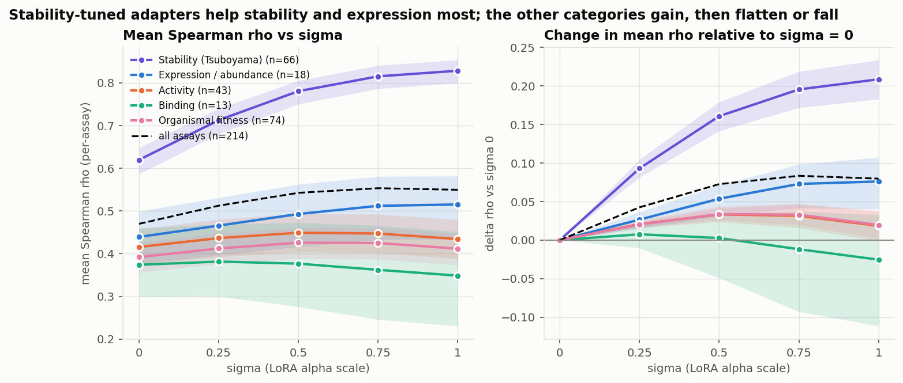

| category | n | mean rho at sigma 0 / .25 / .5 / .75 / 1 | delta at 1.0 [95% CI over assays] | assays improved / harmed by >=0.02 at 1.0 | best sigma of the mean |
|---|---|---|---|---|---|
| Stability | 66 | 0.620 / 0.713 / 0.780 / 0.815 / 0.828 | +0.209 [+0.184, +0.233] | 100% / 0% | 1 |
| Expression | 18 | 0.439 / 0.466 / 0.493 / 0.512 / 0.515 | +0.076 [+0.041, +0.110] | 89% / 6% | 1 |
| Activity | 43 | 0.416 / 0.436 / 0.449 / 0.447 / 0.434 | +0.018 [-0.002, +0.037] | 56% / 26% | 0.5 |
| Binding | 13 | 0.374 / 0.381 / 0.377 / 0.362 / 0.349 | -0.025 [-0.103, +0.033] | 54% / 31% | 0.25 |
| Organismal fitness | 74 | 0.392 / 0.412 / 0.426 / 0.425 / 0.412 | +0.020 [+0.001, +0.037] | 43% / 22% | 0.5 |
| All assays | 214 | 0.470 / 0.512 / 0.542 / 0.553 / 0.550 | +0.080 [+0.063, +0.097] | 68% / 15% | 0.75 |
| All excl. Tsuboyama | 150 | 0.403 / 0.423 / 0.436 / 0.436 / 0.425 | +0.023 [+0.009, +0.036] | 54% / 21% | 0.75 |

---

## 2. Level 1 - all 214 assays

**Mean curves (F01).** Stability rises steeply and saturates; Expression rises more slowly and is still
rising at 0.75-1.0; Activity and Fitness gain a little, peak at 0.5-0.75 and give some of it back; Binding is flat and then falls
(its mean is dominated by one assay, B2L11/Mcl-1 binding, which loses 0.44 at sigma 1; without it the mean is +0.009. Three of the 13 binding assays lose >= 0.10: B2L11, DLG4_RAT and RASK/DARPin).

**Shape of each curve (F03, F04).** Classes use the practical threshold above: *rises/plateaus*, *peak then falls* (interior optimum,
net gain), *peak then net loss*, *flat*, *falls* (never beats sigma 0 and ends >= 0.02 lower).

| category | rises/plateaus | peak then falls | peak then net loss | flat | falls |
|---|---|---|---|---|---|
| Stability (66) | 62 | 3 | 0 | 1 | 0 |
| Expression (18) | 15 | 0 | 0 | 2 | 1 |
| Activity (43) | 21 | 3 | 1 | 8 | 10 |
| Binding (13) | 7 | 0 | 0 | 2 | 4 |
| Organismal fitness (74) | 33 | 12 | 6 | 13 | 10 |

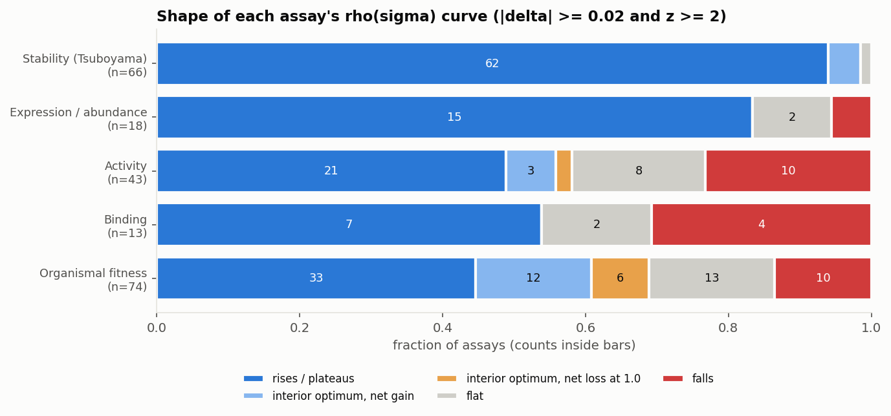
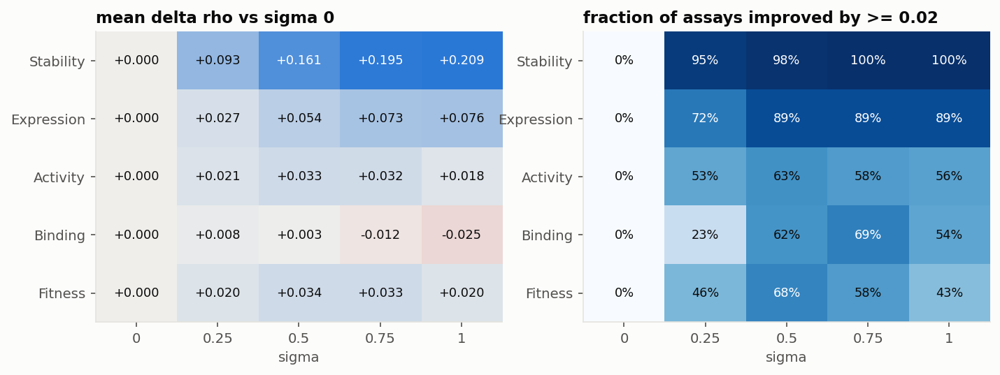

**Spread (F02, F05, F08).** At sigma 1 the per-assay change spans -0.44 to +0.24 outside the Tsuboyama set. The 12 assays most harmed (non-Tsuboyama)
are B2L11 binding to Mcl-1 (-0.44), TADBP (-0.26), HSP82 H2O2 (-0.20), IF1 (-0.20), RPC1 low/high expression (-0.16/-0.13), KCNE1 expression (-0.14),
TRPC_SACS2 (-0.11), DLG4_RAT (-0.11), RASK DARPin binding (-0.10), P84126 (-0.09), SRC Ahler (-0.08). The most helped are SYUA (+0.24), LYAM1 (+0.24), GLPA (+0.16), HIS7 (+0.16), KCNH2 (+0.15), TAT (+0.15) and the p53 Giacomelli screens (+0.13 to +0.14).
Starting point does not predict the gain (Spearman -0.07 between rho at sigma 0 and the gain), nor does protein length (+0.03).

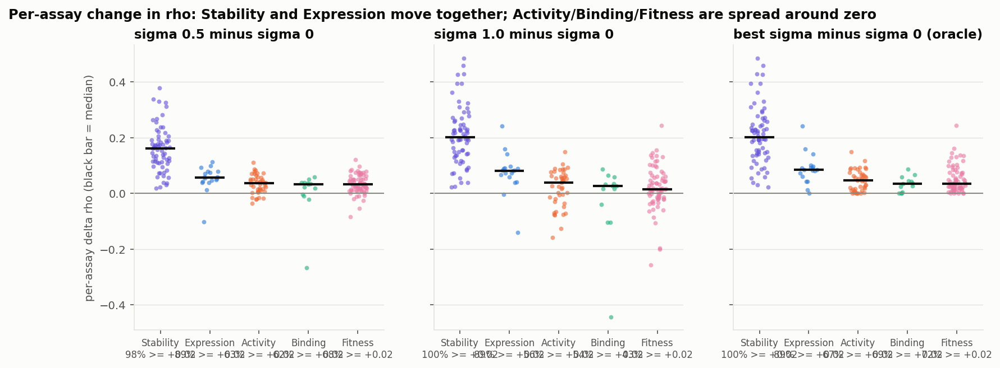
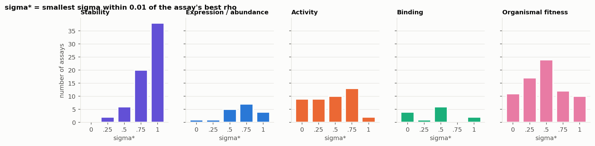
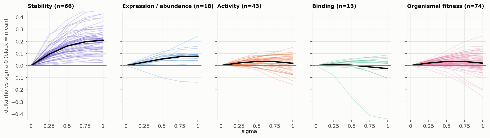

**Where the gain comes from (F06).** Mean change at sigma 1 vs 0, singles only:

| category | between-site | within-site |
|---|---|---|
| Stability | +0.204 | +0.342 |
| Expression | +0.130 | -0.003 |
| Activity | +0.047 | -0.009 |
| Binding | -0.027 | -0.016 |
| Organismal fitness | +0.034 | +0.002 |

So moving toward stability mostly re-ranks sites (buried / folding-critical positions up in importance) and, for non-stability assays,
leaves the choice of substitution at a site unchanged or slightly worse. Between-site rho rises by >= 0.02 in 62% of non-Tsuboyama assays; within-site rises in 28% and falls in 33%.

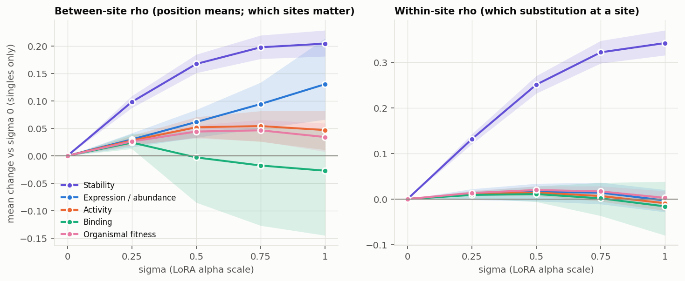

**What changes in the predictions (F09, F18, F19).** Rank correlation between the sigma-1 and sigma-0 predictions is about 0.77-0.78 for non-stability assays (0.76 for Tsuboyama), and about 0.94 at sigma 0.5:
the model moves a long way but most of that is the same direction everywhere (hydrophobic up, polar/charged down; F18). The data do not agree across categories:
Stability assays penalise Pro (-21) and Gly (-12) heavily, Expression/Activity/Binding assays penalise Pro (-13) but are less sensitive to Gly, and the models' Pro shift is slightly positive (+3), i.e. the adapters do not
add a Pro penalty. F19 asks whether an assay with stability-like amino-acid preferences gains more; the relationship is real (p=0.011) but weak.

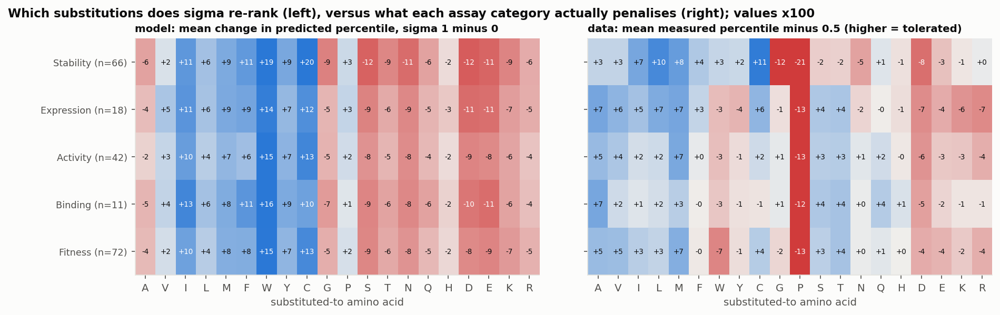
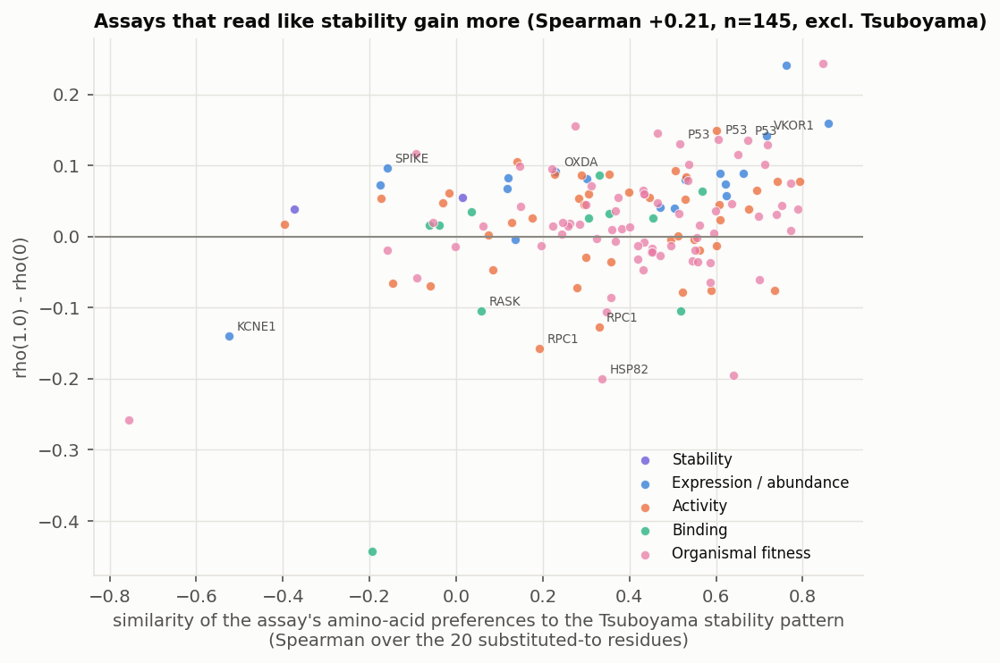
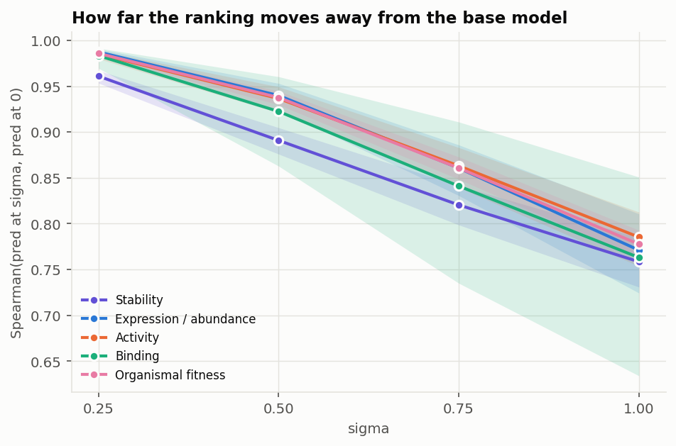
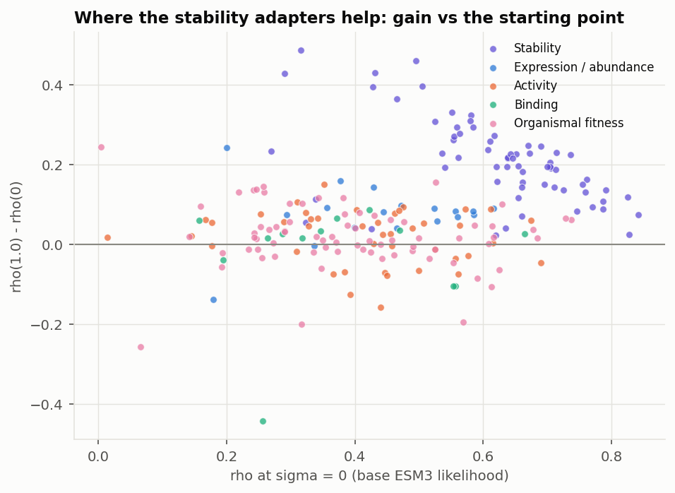

---

## 3. Level 2 - proteins characterised by more than one assay

24 proteins have more than one assay in `DMS_substitutions.csv` (55 assays). I split them into
**A: different properties** (13 proteins), **B: one property under different conditions or cell lines** (5) and **C: replicate measurements of one property** (6).
Annotations (which assay is abundance, activity, binding, ...) are in `scripts/common.py` (`ANNOT`).

| group | rises/plateaus | peak then falls | peak then net loss | flat | falls |
|---|---|---|---|---|---|
| A: different properties | 17 | 1 | 2 | 3 | 5 |
| B: conditions | 7 | 0 | 0 | 3 | 3 |
| C: replicates | 9 | 3 | 0 | 2 | 0 |

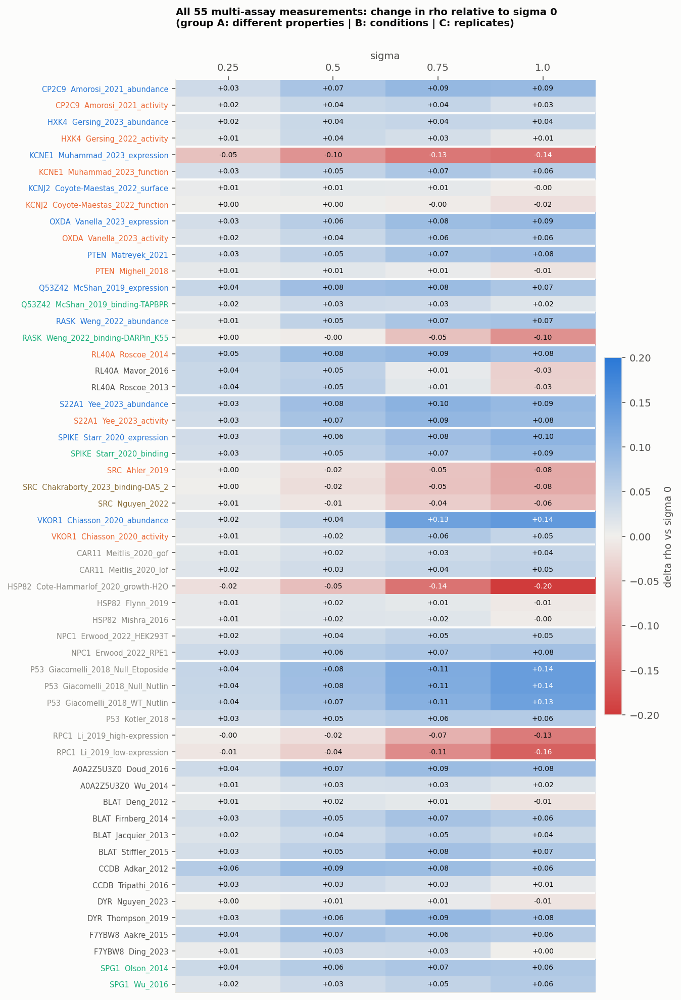

### 3.1 Group A, abundance vs another property (11 proteins)

Columns show rho at sigma 0 / 0.25 / 0.5 / 0.75 / 1.0 on the full assay. "Best joint sigma" is from the shared-mutant analysis (mean of the two gains).

| protein | abundance assay: rho at sigma 0/.25/.5/.75/1 | other assay | other: rho at sigma 0/.25/.5/.75/1 | best joint sigma (shared mutants) | verdict |
|---|---|---|---|---|---|
| CP2C9 | 0.62 / 0.65 / 0.69 / 0.71 / 0.70 (rises/plateaus) | act: Amorosi_2021_activity | 0.66 / 0.68 / 0.70 / 0.71 / 0.69 (rises/plateaus) | 0.75 | improve both |
| HXK4 | 0.40 / 0.42 / 0.44 / 0.44 / 0.44 (rises/plateaus) | act: Gersing_2022_activity | 0.46 / 0.47 / 0.49 / 0.48 / 0.47 (peak then falls) | 0.5 | other improves only up to sigma* |
| KCNE1 | 0.18 / 0.13 / 0.08 / 0.05 / 0.04 (falls) | act: Muhammad_2023_function | 0.29 / 0.31 / 0.33 / 0.36 / 0.34 (rises/plateaus) | 0 | inverse trade-off (abundance down, other up) |
| KCNJ2 | 0.34 / 0.34 / 0.35 / 0.35 / 0.33 (flat) | act: Coyote-Maestas_2022_function | 0.31 / 0.31 / 0.31 / 0.31 / 0.29 (flat) | 0.5 | neither moves |
| OXDA | 0.36 / 0.39 / 0.41 / 0.44 / 0.45 (rises/plateaus) | act: Vanella_2023_activity | 0.33 / 0.35 / 0.37 / 0.39 / 0.39 (rises/plateaus) | 1 | improve both |
| PTEN | 0.44 / 0.47 / 0.49 / 0.52 / 0.52 (rises/plateaus) | act: Mighell_2018 | 0.52 / 0.54 / 0.54 / 0.53 / 0.51 (flat) | 0.75 | abundance only |
| Q53Z42 | 0.56 / 0.60 / 0.64 / 0.64 / 0.63 (rises/plateaus) | bind: McShan_2019_binding-TAPBPR | 0.32 / 0.33 / 0.35 / 0.35 / 0.33 (rises/plateaus) | 0.75 | improve both |
| RASK | 0.29 / 0.30 / 0.34 / 0.36 / 0.37 (rises/plateaus) | bind: Weng_2022_binding-DARPin_K55 | 0.55 / 0.55 / 0.55 / 0.50 / 0.45 (falls) | 0.5 | trade-off (abundance up, other down) |
| S22A1 | 0.52 / 0.56 / 0.60 / 0.62 / 0.61 (rises/plateaus) | act: Yee_2023_activity | 0.47 / 0.50 / 0.54 / 0.56 / 0.55 (rises/plateaus) | 0.75 | improve both |
| SPIKE | 0.47 / 0.50 / 0.53 / 0.55 / 0.57 (rises/plateaus) | bind: Starr_2020_binding | 0.42 / 0.45 / 0.47 / 0.49 / 0.51 (rises/plateaus) | 1 | improve both |
| VKOR1 | 0.43 / 0.45 / 0.47 / 0.56 / 0.57 (rises/plateaus) | act: Chiasson_2020_activity | 0.33 / 0.34 / 0.35 / 0.39 / 0.37 (rises/plateaus) | 0.75 | improve both |

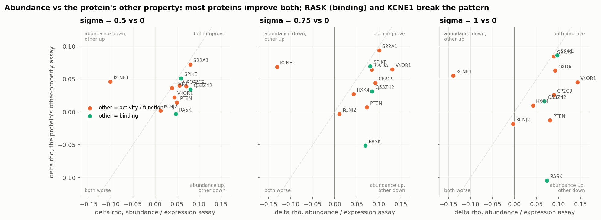
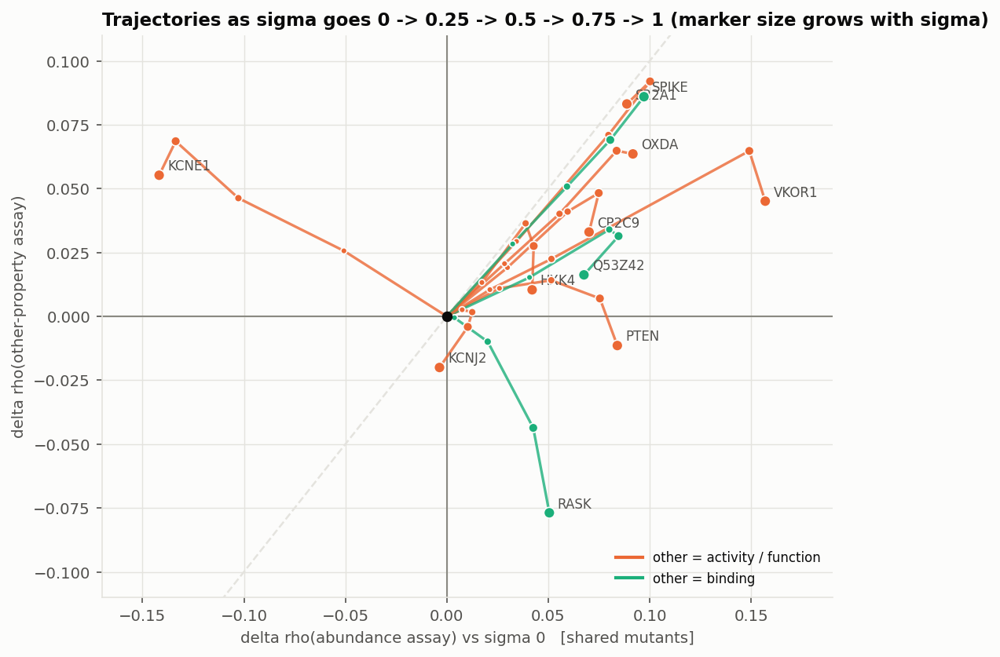
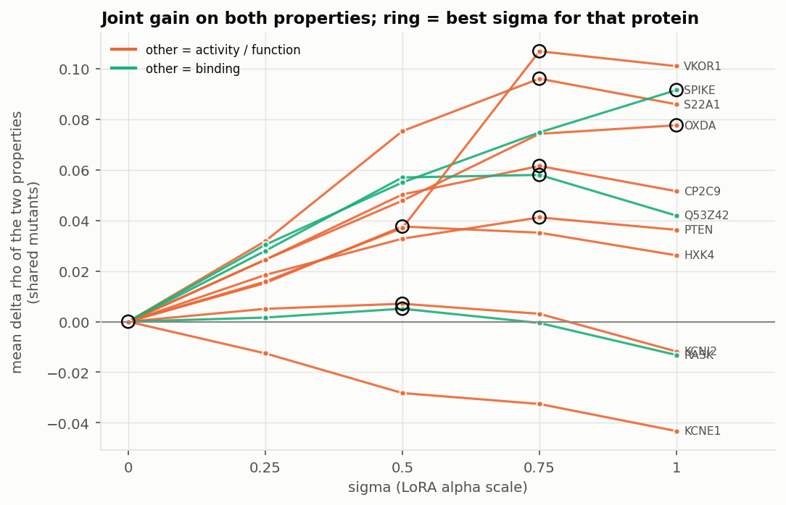
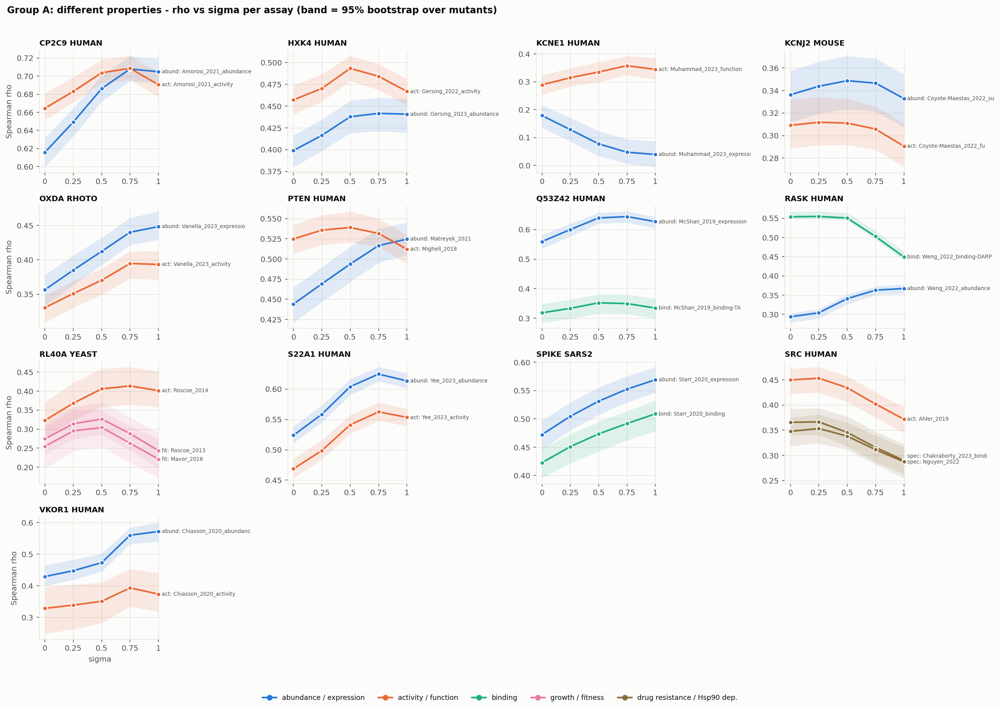

Per-protein reading (observations first, interpretation marked as such):

- **CP2C9** (abundance, probe-binding activity; labels agree, r=0.75). Both rise to 0.75; activity gives back 0.02 by 1.0. Improve both. (ProteinGym files CP2C9 activity under the coarse type *Binding*, as a probe-binding readout.)
- **OXDA** (expression, activity). Both rise to 0.75 and plateau. Improve both (+0.09 / +0.06).
- **S22A1** (abundance, substrate uptake; r=0.75). Both rise to 0.75 (+0.10 / +0.09) and dip a little at 1.0. Improve both, equal gains.
- **SPIKE RBD** (expression, ACE2 binding; r=0.74). Both rise all the way to 1.0 (+0.10 / +0.09). The cleanest "stability helps binding" case. Improve both.
- **VKOR1** (abundance, activity). Both rise, with a jump at 0.75 (abundance +0.13). Activity set is small (n=697), so its curve is noisy. Improve both.
- **Q53Z42 / HLA-A** (surface expression, TAPBPR binding). Both peak at 0.5-0.75 (+0.08 / +0.03) and decline slightly. Improve both, modestly for binding.
- **HXK4 / glucokinase** (abundance, activity by complementation). Abundance rises to 0.75 (+0.04); activity rises to 0.5 (+0.04) and is back to +0.01 by 1.0. **Other improves only up to sigma 0.5.**
- **PTEN** (VAMP-seq abundance vs lipid-phosphatase yeast growth, different labs). Abundance +0.08 to 1.0; activity +0.014 at 0.5, -0.013 at 1.0. **Abundance only.** Between-site gain for activity is ~0 while for abundance it is +0.11 (F17).
- **RASK / KRAS** (AbundancePCA, DARPin K55 binding). Abundance +0.07; binding is flat through 0.5 (0.554 / 0.555 / 0.551), then 0.503 and 0.449. **A true trade-off, with a free sigma <= 0.5.**
  The loss is between-site (-0.06 vs +0.14 for abundance, F17). Interpretation (not tested here): the binding data are dominated by interface positions, which a stability-weighted site ranking de-emphasises.
- **KCNE1** (surface expression with KCNQ1, channel function). Surface expression falls from 0.18 to 0.04, function rises from 0.29 to 0.36 (peak at 0.75). **Inverse trade-off**, and the one protein in the set where the "other" property gains much more than abundance.
  Observation from the dossier: in the expression data Pro and Gly are the *most* tolerated substitutions and hydrophobics the least (mean percentile 0.55/0.56 vs 0.47), the opposite of the pattern the adapters push (F18). Interpretation (not tested): KCNE1 is a small
  single-pass membrane protein whose surface level depends on partner (KCNQ1) co-assembly and trafficking, not on folding stability.
- **KCNJ2 / Kir2.1** (surface trafficking, conduction). Surface: +0.013 at 0.5, 0.000 at 1.0; function: flat to -0.02. **Neither moves** within noise.

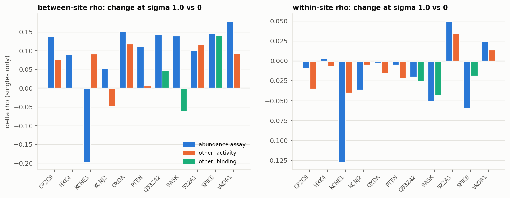
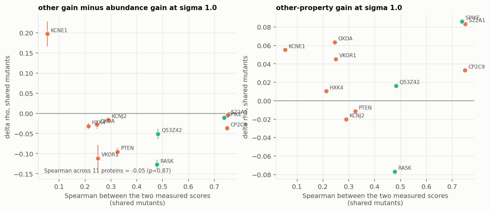

**Does agreement between the two measured properties predict who benefits?** Only partly. The three pairs with strongly correlated labels (CP2C9, S22A1, SPIKE; r about 0.75) all improve both, but across the 11 proteins the correlation between label agreement and
"other gain minus abundance gain" is -0.05 (F16), because the weak-agreement proteins (r about 0.05-0.3) split between OXDA, VKOR1 (other improves), HXK4, PTEN, KCNJ2 (it does not) and KCNE1 (it improves, abundance falls).

### 3.2 Group A, no abundance partner: ubiquitin and Src

| protein | assay | what it measures | rho at sigma 0/.25/.5/.75/1 | delta at 1.0 | shape |
|---|---|---|---|---|---|
| RL40A | Roscoe_2014 | E1 reactivity | 0.32 / 0.37 / 0.41 / 0.41 / 0.40 | +0.078 | rises/plateaus (sigma*=0.5) |
| RL40A | Mavor_2016 | yeast growth (stress DMSO) | 0.25 / 0.30 / 0.30 / 0.26 / 0.22 | -0.034 | peak then net loss (sigma*=0.25) |
| RL40A | Roscoe_2013 | yeast growth | 0.27 / 0.31 / 0.33 / 0.29 / 0.24 | -0.031 | peak then net loss (sigma*=0.5) |
| SRC | Ahler_2019 | kinase activity (yeast toxicity) | 0.45 / 0.45 / 0.43 / 0.40 / 0.37 | -0.078 | falls (sigma*=0) |
| SRC | Chakraborty_2023_binding-DAS_25uM | dasatinib resistance | 0.37 / 0.37 / 0.35 / 0.32 / 0.29 | -0.076 | falls (sigma*=0) |
| SRC | Nguyen_2022 | Hsp90 dependence | 0.35 / 0.35 / 0.34 / 0.31 / 0.29 | -0.060 | falls (sigma*=0) |

- **Ubiquitin (RL40A)**: E1 reactivity (Roscoe 2014) rises to 0.5-0.75 (+0.08 to +0.09) and stays there. Yeast growth (Roscoe 2013, Mavor 2016) peaks at 0.25-0.5 (+0.04 to +0.05) and **falls to net loss (-0.03) by 1.0**.
  Two measurements of the *same* property (growth) agree here, so this is a property split: sigma beyond ~0.5 helps the biochemical readout and hurts the organismal one.
- **Src** (kinase-domain DMS in yeast, dasatinib resistance, Hsp90 dependence). All three fall monotonically after sigma 0.25 (-0.06 to -0.08 at sigma 1). Between-site rho drops about -0.13 for all three while within-site rises slightly (dossier). **No sigma > 0.25 helps any Src readout.**
  Interpretation (not tested): high-scoring Src variants in these assays include regulatory/activating mutations rather than stable-and-active ones, which a stability prior ranks low (the Chakraborty abstract links resistance to autoinhibition and hyperactivation).

### 3.3 Group B, one property, different conditions

| protein | assay | what it measures | rho at sigma 0/.25/.5/.75/1 | delta at 1.0 | shape |
|---|---|---|---|---|---|
| CAR11 | Meitlis_2020_gof | signaling + ibrutinib (GOF) | 0.28 / 0.29 / 0.30 / 0.31 / 0.32 | +0.043 | rises/plateaus (sigma*=0.75) |
| CAR11 | Meitlis_2020_lof | signaling (LOF) | 0.39 / 0.41 / 0.42 / 0.43 / 0.44 | +0.048 | rises/plateaus (sigma*=0.75) |
| HSP82 | Cote-Hammarlof_2020_growth-H2O2 | growth, H2O2, middle domain | 0.32 / 0.30 / 0.26 / 0.18 / 0.12 | -0.200 | falls (sigma*=0) |
| HSP82 | Flynn_2019 | growth, 37C, full length | 0.35 / 0.36 / 0.37 / 0.37 / 0.35 | -0.007 | flat (sigma*=0.25) |
| HSP82 | Mishra_2016 | growth, ATPase domain | 0.40 / 0.41 / 0.42 / 0.42 / 0.40 | -0.003 | flat (sigma*=0.25) |
| NPC1 | Erwood_2022_HEK293T | HEK293T | 0.56 / 0.58 / 0.60 / 0.61 / 0.61 | +0.048 | rises/plateaus (sigma*=0.75) |
| NPC1 | Erwood_2022_RPE1 | RPE1 | 0.25 / 0.29 / 0.31 / 0.32 / 0.33 | +0.075 | flat (sigma*=0.75) |
| P53 | Giacomelli_2018_Null_Etoposide | null + etoposide | 0.24 / 0.28 / 0.32 / 0.36 / 0.38 | +0.136 | rises/plateaus (sigma*=1) |
| P53 | Giacomelli_2018_Null_Nutlin | null + nutlin | 0.25 / 0.29 / 0.33 / 0.36 / 0.38 | +0.137 | rises/plateaus (sigma*=1) |
| P53 | Giacomelli_2018_WT_Nutlin | WT + nutlin (dominant-negative) | 0.22 / 0.26 / 0.29 / 0.32 / 0.35 | +0.131 | rises/plateaus (sigma*=1) |
| P53 | Kotler_2018 | H1299 growth (DBD) | 0.45 / 0.48 / 0.51 / 0.52 / 0.52 | +0.061 | rises/plateaus (sigma*=0.5) |
| RPC1 | Li_2019_high-expression | repressor, high expression | 0.39 / 0.39 / 0.37 / 0.32 / 0.27 | -0.127 | falls (sigma*=0) |
| RPC1 | Li_2019_low-expression | repressor, low expression | 0.44 / 0.43 / 0.40 / 0.33 / 0.28 | -0.158 | falls (sigma*=0) |

Same property can behave very differently across conditions: HSP82 under H2O2 (middle domain) loses 0.20 while the other two Hsp90 assays are flat (-0.01, 0.00);
λ CI repressor loses 0.13 to 0.16 at both expression levels (domain 19-77); p53 gains +0.13/+0.14 in the three Giacomelli screens and +0.06 in Kotler's. CARD11 gain- and loss-of-function both rise (+0.04/+0.05); NPC1 is +0.05 (HEK293T) and +0.08 (RPE1, n=63, not significant).
The three Giacomelli screens (null cells with nutlin or etoposide, wild-type cells with nutlin) move together, all +0.13 to +0.14.

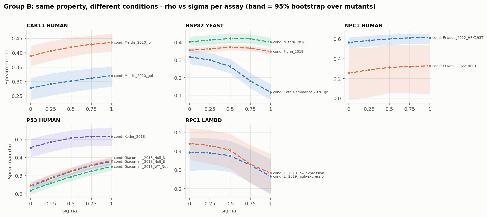

### 3.4 Group C, replicates of one property (noise floor)

| protein | assay | what it measures | rho at sigma 0/.25/.5/.75/1 | delta at 1.0 | shape |
|---|---|---|---|---|---|
| A0A2Z5U3Z0 | Doud_2016 | viral growth | 0.41 / 0.44 / 0.48 / 0.49 / 0.49 | +0.080 | rises/plateaus (sigma*=0.75) |
| A0A2Z5U3Z0 | Wu_2014 | viral growth | 0.36 / 0.38 / 0.39 / 0.39 / 0.38 | +0.019 | rises/plateaus (sigma*=0.5) |
| BLAT | Deng_2012 | Amp MIC | 0.52 / 0.54 / 0.54 / 0.54 / 0.51 | -0.013 | flat (sigma*=0.25) |
| BLAT | Firnberg_2014 | Amp growth | 0.74 / 0.76 / 0.79 / 0.81 / 0.80 | +0.061 | rises/plateaus (sigma*=0.75) |
| BLAT | Jacquier_2013 | Amox MIC | 0.68 / 0.70 / 0.71 / 0.73 / 0.72 | +0.037 | rises/plateaus (sigma*=0.75) |
| BLAT | Stiffler_2015 | Amp growth | 0.73 / 0.76 / 0.78 / 0.81 / 0.79 | +0.065 | rises/plateaus (sigma*=0.75) |
| CCDB | Adkar_2012 | toxicity | 0.34 / 0.40 / 0.43 / 0.43 / 0.41 | +0.065 | peak then falls (sigma*=0.5) |
| CCDB | Tripathi_2016 | toxicity | 0.42 / 0.45 / 0.46 / 0.45 / 0.43 | +0.009 | peak then falls (sigma*=0.25) |
| DYR | Nguyen_2023 | growth | 0.41 / 0.41 / 0.42 / 0.42 / 0.40 | -0.012 | flat (sigma*=0) |
| DYR | Thompson_2019 | growth | 0.38 / 0.41 / 0.45 / 0.48 / 0.46 | +0.076 | rises/plateaus (sigma*=0.75) |
| F7YBW8 | Aakre_2015 | growth | 0.30 / 0.34 / 0.37 / 0.36 / 0.35 | +0.056 | rises/plateaus (sigma*=0.5) |
| F7YBW8 | Ding_2023 | growth | 0.61 / 0.61 / 0.64 / 0.64 / 0.61 | +0.001 | peak then falls (sigma*=0.5) |
| SPG1 | Olson_2014 | IgG binding | 0.37 / 0.41 / 0.43 / 0.44 / 0.44 | +0.064 | rises/plateaus (sigma*=0.5) |
| SPG1 | Wu_2016 | IgG binding | 0.16 / 0.18 / 0.19 / 0.20 / 0.22 | +0.060 | rises/plateaus (sigma*=1) |

Replicate assays of the same property do not always agree: the spread of the sigma-1 gain within a protein is 0.079 (BLAT), 0.088 (DYR), 0.056 (CCDB), 0.055 (F7YBW8), 0.061 (influenza HA), 0.004 (SPG1/GB1). Concretely, BLAT Deng 2012 (MIC) is flat while the three other beta-lactamase assays gain +0.04 to +0.07,
and DYR Nguyen 2023 is flat while Thompson 2019 gains +0.08. **Differences of about 0.05 between two assays of different properties should therefore not be read as property effects**; the clear cases in Group A (|delta| >= 0.10 for KCNE1 and RASK, and the same -0.06 to -0.08 drop in all three Src assays) are outside this.

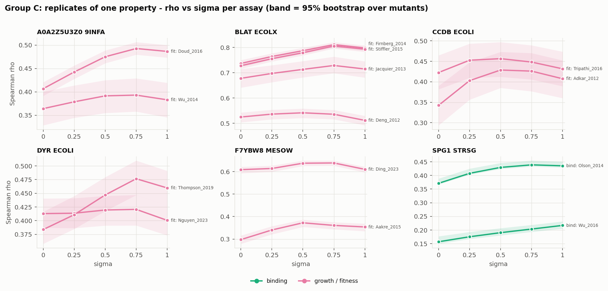

---

## 4. Level 3 - per-protein dossiers

`figures/dossiers/<PROTEIN>.png` (24 files). Each has: rho vs sigma with bootstrap bands; the change in between-site and within-site rho; the measured mean percentile by substituted-to amino-acid class;
the change in predicted percentile by class; and per-position strips (measured score of every assay, predicted at sigma 0 / 0.5 / 1) to show *where* in the sequence the ranking moves.

Most informative: `KCNE1_HUMAN`, `RASK_HUMAN`, `SRC_HUMAN`, `HSP82_YEAST`, `RPC1_LAMBD`, `PTEN_HUMAN`, `SPIKE_SARS2`, `RL40A_YEAST`.

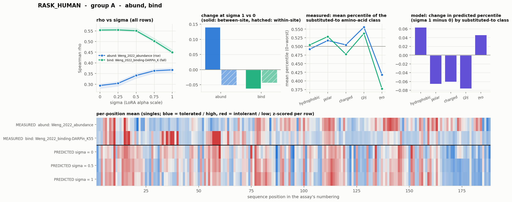
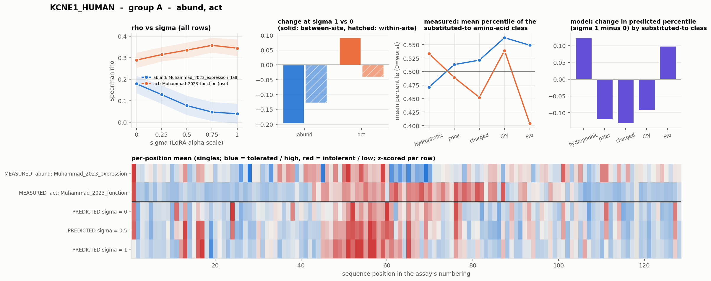
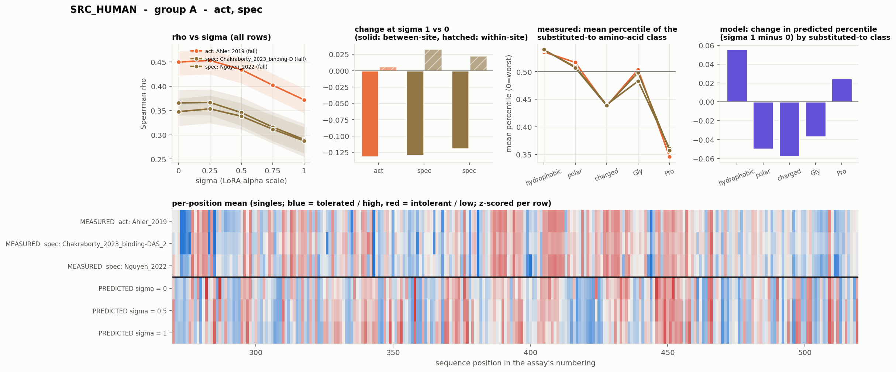

---

## 5. The trade-off taxonomy, in one table

| pattern when sigma goes 0 to 1 | examples (relative to the protein's abundance assay where one exists) |
|---|---|
| Both properties rise and plateau (stability helps everything) | CP2C9, OXDA, S22A1, SPIKE, VKOR1, Q53Z42; also CAR11 (both), NPC1, p53, most BLAT / SPG1 |
| Abundance rises; the other property rises to sigma* then returns to baseline | HXK4 (sigma*=0.5), PTEN (0.5), CP2C9 activity (0.75, mild), RL40A growth (0.25-0.5, then net loss) |
| Abundance rises; the other property falls after a flat stretch (**true trade-off**) | RASK DARPin binding (free up to 0.5) |
| Abundance falls; the other rises | KCNE1 (expression falls, function rises) |
| Neither moves | KCNJ2 |
| No sigma helps by 0.02 or more; falls from sigma 0.25-0.5 | Src (3 assays; flat to 0.25), HSP82 H2O2, λ CI repressor |

---

## 6. Caveats

- **One model, one seed, 214 of 217 assays**; no run-to-run variance is available, so the Group C spread (about 0.05) is the best proxy for noise.
- **Tsuboyama leakage.** `leak_audit/out/esm_msr_pg_clean.json` (for the released model) flags 23 Tsuboyama assays as overlapping training data. I did not re-split them here, so the Stability gain is probably an upper bound.
  The non-stability results are not affected by that audit.
- **sigma = 0** is taken to be the stability-free model (adapters scaled to zero), not independently verified.
- **Multi-mutant rows.** Rho on all rows includes double mutants for Tsuboyama, RASK, SPG1 and F7YBW8 (69 assays have them); singles-only rho is often higher (e.g. Tsuboyama at sigma 1 about 0.9 vs 0.85). Between/within-site and the shared-mutant analyses use singles.
  RASK binding falls under both conventions (-0.105 all rows, -0.077 singles).
- **Property labels** are my reading of the ProteinGym metadata and the papers (see `ANNOT`). `SPEC` (Src drug resistance, Hsp90 dependence) is not an abundance/activity/binding axis, and Group A "FIT" are growth assays.
- Interpretations flagged "not tested" are hypotheses, not findings.
- The bootstrap bands in F12-F14 are for each assay's own rho; they overlap more than the paired differences used for the classes (z-scores) would suggest.

## 7. Files

- `figures/F01-F20*.png` summary and group-level figures; `figures/dossiers/*.png` per-protein figures.
- `tables/per_assay_rho.csv` (rho, singles-only rho, between/within-site for every assay and sigma), `assay_classes.csv`, `abundance_vs_other_pairs.csv`, `abundance_vs_other_shared_mutants.csv`,
  `summary_category.csv`, `summary_class_counts.csv`, `sigma_shift_by_target_aa.csv`, `measured_percentile_by_target_aa.csv`, `stability_likeness_vs_gain.csv`, `prediction_shift_vs_sigma0.csv`, `nonTsuboyama_ranked_by_delta_full.csv`, `boot_rho.pkl`.
- `scripts/run_all.sh` re-runs everything (reads whatever CSVs exist in `sigma*_wt_only/`, so re-run it once the missing assays are added). `scripts/common.py` holds the paths, thresholds and the protein/assay annotations.

## 8. Follow-up: rank-based selection view

See `REPORT_rank.md`: ranking mutants by prediction and looking at top-K measured scores (forward), the same by measurement and model rank (inverse), and effects on other properties for the 11 abundance-vs-other proteins.
Main result: sigma improves the identification of damaging mutants (bottom of the ranking) but not the top picks, whose composition shifts toward large hydrophobic substitutions; the other property of the picks drops by about 0.014 in mean percentile at sigma 1.
