# Rank-based view: which mutants does the stability-focused model select, and what do they do to other properties?

Follow-up to `REPORT.md`. Same predictions (`wt_only`, sigma 0 / 0.5 / 1; the 0.25 and 0.75 runs were not used here), same 214 assays, **single mutants only**.
206 assays have at least 200 singles and enter the all-assay analysis (142 outside the Tsuboyama stability set). Percentiles are within assay (within the shared mutant set for cross-assay pairs), 1 = best.
"Worst quartile" = measured percentile <= 0.25. Random selection gives a mean percentile of 0.5 and a worst-quartile rate of 0.25.

**Forward** = rank all mutants by predicted score, take the top K%, look at their measured scores. **Inverse** = rank by measured score, take the top K%, look at where the model put them.
Scripts: `10_rank_stats.py`, `11_fig_rank.py`, `12_rank_extra.py`; tables in `tables/rank_*.{pkl,csv}`.

## Short answer

1. **Sigma helps the bottom of the ranking, not the top.** For non-Tsuboyama assays, the worst-predicted 10% of mutants get measurably worse in the data (mean percentile 0.294 at sigma 0, 0.257 at 0.5, 0.246 at 1; 85% of assays improve) and the false-alarm rate (worst-predicted mutants that are actually in the top quartile) falls from 8.0% to 4.8%.
   The *top* of the ranking, which is what "mutants selected by the model" means, does not improve: top-10% mean percentile 0.657 / 0.658 / 0.641 at sigma 0 / 0.5 / 1, and the worst-quartile rate among picks rises from 8.2% to 10.3%. 68% of assays have a lower top-10% quality at sigma 1 than at sigma 0.
   This is why mean rho rises while selection quality does not: rho is dominated by separating damaging from neutral mutants.
2. **Stability assays are the exception**: top-10% mean percentile 0.750 / 0.846 / 0.870, worst-quartile rate 1.8% / 0.4% / 0.6%.
3. **The sigma-1 picks are a different set.** Only 50% of the top-10% mutants at sigma 1 are also in the sigma-0 top 10%. The share of picks whose substituted-to residue is W, C, F, I or M goes from 14% to 32% (hydrophobic overall 39% to 59%; polar or charged 56% to 38%).
   The picks swapped in are 45% W/C/F/I/M (those swapped out: 9%) and score lower in the data (mean percentile 0.613 vs 0.645). This matches the substitution shift in F18 of the main report and explains the extra worst-quartile picks.
4. **Cross-property costs are small, on average, and mostly come from this swap.** For the 11 abundance-vs-other proteins, going from sigma 0 to 1 changes the other property of the picks by -0.014 in mean percentile (95% CI -0.021 to -0.007) and raises the other property's worst-quartile rate by 1.6 points (+0.6 to +2.9). The abundance of the picks itself does not improve either (-0.015, CI -0.036 to +0.004).
5. **The model's picks are safer for other properties than the true best on abundance.** Choosing the true top-10% on abundance gives a mean percentile of 0.634 (0.560 to 0.708) and a worst-quartile rate of 16% (9% to 23%) in the other property. The model's picks (sigma 0 to 1) give 0.671 to 0.657 and 7% to 9%.
   The model favours conservative mutations that rarely break anything, while the truly best mutations for one property are often neutral-to-bad for another.
6. **Inverse direction**: true top-10% mutants of non-stability assays sit at mean model percentile 0.641 / 0.653 / 0.650 (sigma 0 / 0.5 / 1). Sigma helps recall only a little (+0.01), and the rate at which the true-best end up in the model's worst quartile falls from 10.2% to 8.5%. For Stability assays recall rises strongly (0.685 / 0.808 / 0.860).

## 1. All assays, own property

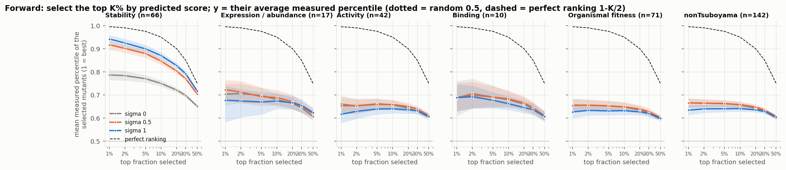
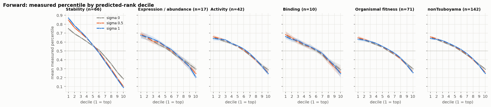

Forward curves: Stability picks improve at every K as sigma rises (top 1%: 0.79 to 0.94). For Expression, Activity, Binding and Fitness the curves for sigma 0 and 0.5 overlap and sigma 1 sits lower at small K, with wide bands (few assays, heterogeneous).

Top-10% summary, mean over assays (sigma 0 / 0.5 / 1):

| category | n | picks: mean measured pct | picks: worst-quartile rate | true-best: mean model pct |
|---|---|---|---|---|
| Stability | 66 | 0.750 / 0.846 / 0.870 | 0.018 / 0.004 / 0.006 | 0.685 / 0.808 / 0.860 |
| Expression | 17 | 0.680 / 0.689 / 0.674 | 0.064 / 0.066 / 0.086 | 0.655 / 0.669 / 0.675 |
| Activity | 42 | 0.657 / 0.659 / 0.640 | 0.079 / 0.080 / 0.101 | 0.640 / 0.653 / 0.649 |
| Binding | 10 | 0.679 / 0.683 / 0.662 | 0.060 / 0.066 / 0.094 | 0.644 / 0.654 / 0.652 |
| Organismal fitness | 71 | 0.648 / 0.648 / 0.632 | 0.093 / 0.093 / 0.109 | 0.639 / 0.650 / 0.645 |
| non-Tsuboyama (all) | 142 | 0.657 / 0.658 / 0.641 | 0.082 / 0.084 / 0.103 | 0.641 / 0.653 / 0.650 |

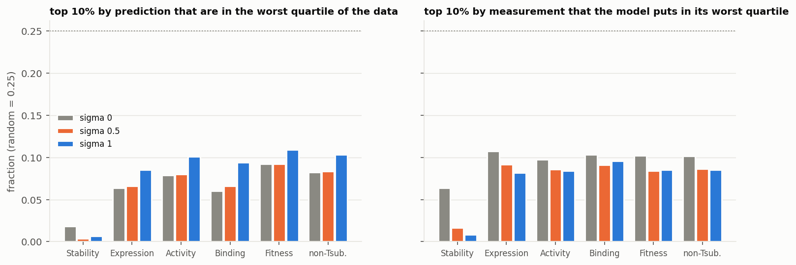
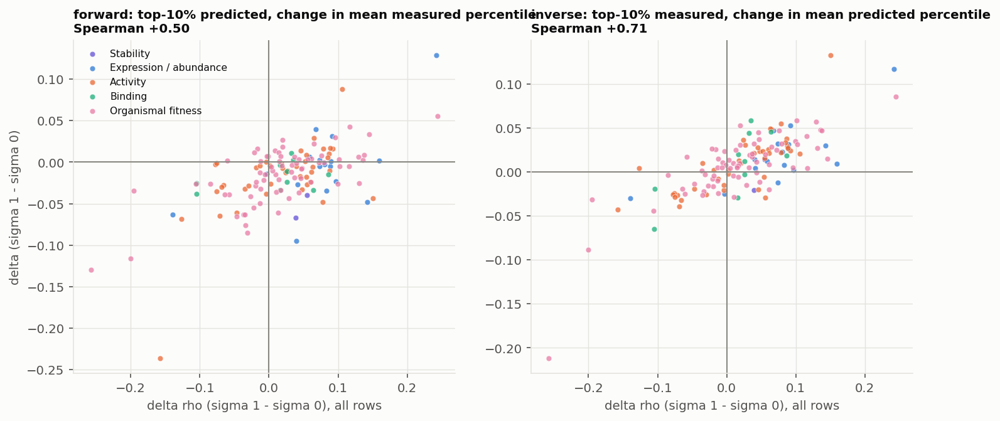

F26: the change in rho and the change in top-10% quality are positively but imperfectly related across assays (Spearman +0.50 forward, +0.71 inverse), so assays with large rho gains tend to also gain at the top, but the average gain at the top is below zero.

## 2. Inverse: where does the model put the true best?

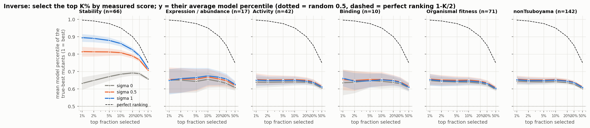
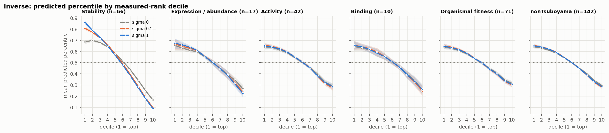

Non-stability assays show a mean model percentile of only about 0.65 for the true-best mutants at all three sigmas: the model finds true-best mutants somewhat better than chance but not strongly, and stability tuning adds little. Only for stability assays does sigma 1 place the true best at the top (0.86).

## 3. Cross-property selection (11 abundance-vs-other proteins, shared single mutants)

Top 10% by the model, mean over proteins (95% CI over proteins):

| quantity | sigma 0 | sigma 0.5 | sigma 1 | sigma 1 minus 0 |
|---|---|---|---|---|
| abundance of the picks, mean pct | 0.683 | 0.685 | 0.668 | -0.015 [-0.036, +0.004] |
| other property of the picks, mean pct | 0.671 | 0.674 | 0.657 | -0.014 [-0.021, -0.007] |
| other property, worst-quartile rate | 0.072 | 0.068 | 0.089 | +0.016 [+0.006, +0.029] |
| abundance, worst-quartile rate | 0.060 | 0.064 | 0.084 | +0.025 [+0.002, +0.053] |

Reference (selection by the *true* top-10% in assay 1, evaluated in assay 2): different properties 0.634 mean pct / 16% worst quartile; same property under other conditions 0.705 / 4.0%; replicate assays 0.749 / 3.7% (F30).
True-best on the other property rank at model percentile 0.647 / 0.656 / 0.654 (sigma 0 / 0.5 / 1); true-best on abundance at 0.635 / 0.643 / 0.649, so recall is flat in sigma.

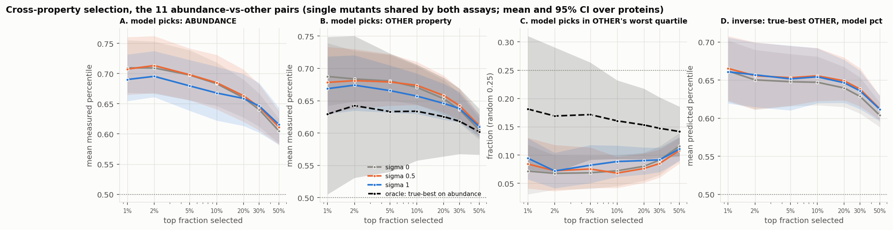
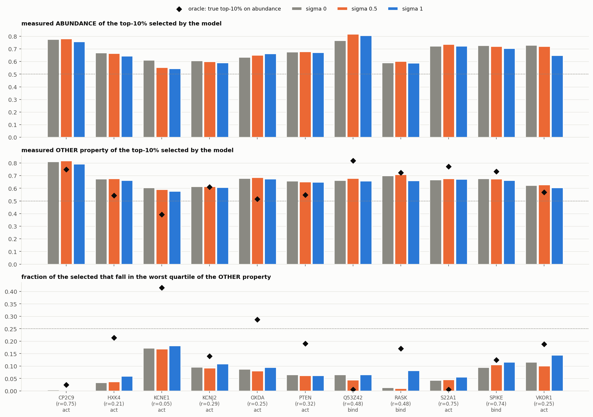
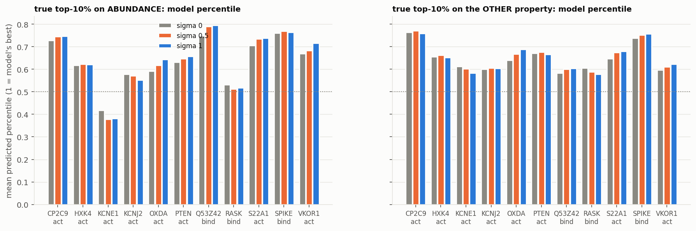
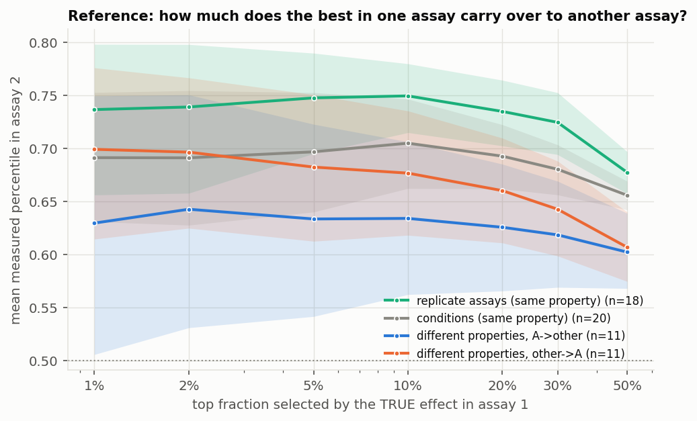
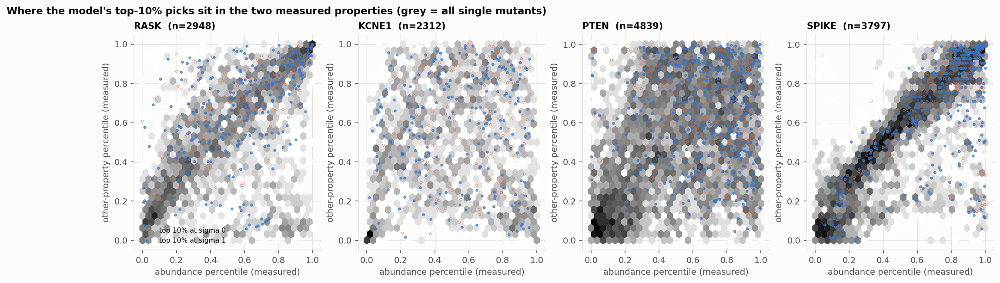

Per protein, the change in the other property's mean percentile of the top 10% from sigma 0 to 1: RASK -0.038 (worst-quartile rate 1% to 8%), KCNE1 -0.028, CP2C9 -0.018, VKOR1 -0.017, SPIKE -0.015, HXK4 -0.013, PTEN -0.011, KCNJ2 -0.006, OXDA -0.004, Q53Z42 -0.004, S22A1 +0.006.
Change in the abundance of the picks: VKOR1 -0.080, KCNE1 -0.067, HXK4 -0.028, SPIKE -0.023, CP2C9 -0.017, KCNJ2 -0.017, PTEN -0.003, RASK -0.002, S22A1 0.000, OXDA +0.027, Q53Z42 +0.040.
For KCNE1 the picks are barely better than random for either property at any sigma, which fits its near-zero rho; for RASK the sigma-0 and 0.5 picks are almost never bad for binding, and sigma 1 introduces the failures (F31).

## Caveats

- Top-K statistics on 10% of a few thousand mutants are noisy per protein; the pooled numbers and CIs over proteins are more reliable than any single bar. The cross-property pooled CIs are over 11 proteins.
- Percentile of measured score is rank-based; assays with many tied near-wild-type scores make "top" and "worst quartile" fuzzy.
- The substitution-composition explanation (point 3) is supported by the swapped-in/out comparison but I did not test it causally (e.g. by down-weighting hydrophobic targets).
- 8 of the 214 assays have fewer than 200 singles and are excluded here.
