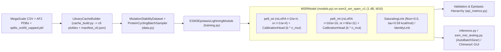

# ESM-MSR Codebase Specification & Infrastructure Audit

*Updated 2026-10-31 — Authoritative specification covering unified workspace checkout on `devel-revision` (`c5b96e5`), pinned training worktrees in `dc_runs/pin_*`, and GPU queue execution harnesses.*

---

## Executive Overview & Workspace Topology

The repository consolidates model architectures, training recipes, inference tooling, and the authoritative benchmark evaluation suite into a unified codebase. To preserve complete execution reproducibility during active development, training runs operate within dedicated, detached git checkouts pinned at stable recipe commits.

| Checkout / Worktree | Branch / Ref (`HEAD`) | Primary Role & Operational Status |
| :--- | :--- | :--- |
| [`repo/`](file:///home/sareeves/playground/esm-msr-devel/repo) | `devel-revision` (`c5b96e5`) | **Active Workspace Root**: Consolidated codebase containing modern trimmed training (`src/esm_msr/`), preset YAML configurations (`configs/`), authoritative evaluation suite ([`inference_scripts/esm_msr_testing.py`](file:///home/sareeves/playground/esm-msr-devel/repo/inference_scripts/esm_msr_testing.py)), canonical docs ([`BENCHMARKS_OCT2026.md`](file:///home/sareeves/playground/esm-msr-devel/repo/docs/BENCHMARKS_OCT2026.md)), and the [`ChimeraX-ESM_MSR`](file:///home/sareeves/playground/esm-msr-devel/repo/ChimeraX-ESM_MSR/src/tool.py) extension bundle. |
| [`dc_runs/pin_trim_912e38d/`](file:///home/sareeves/playground/esm-msr-devel/dc_runs/pin_trim_912e38d) | `5e9ae92` (detached) | **Pinned Training Worktree**: Locked snapshot incorporating commit `d9a60c3` (identity link and target module ablation support). Isolates long-running GPU training jobs from active workspace file modifications. |
| [`dc_runs/`](file:///home/sareeves/playground/esm-msr-devel/dc_runs) | Host file system | **Harness & Queue Automation**: Shell runners ([`queue_ns.sh`](file:///home/sareeves/playground/esm-msr-devel/dc_runs/queue_ns.sh), [`trim_run.sh`](file:///home/sareeves/playground/esm-msr-devel/dc_runs/trim_run.sh)) managing sequential batch executions, PID handover, and GPU health checks on the local RTX 5090 (GPU 0). |

---

## Part I: Current System Specification

### 1. Data, Splits & Two-Source Censoring
- **Reference recovery & replicate collapse** ([`preprocess_megascale.py`](file:///home/sareeves/playground/esm-msr-devel/repo/src/esm_msr/preprocess_megascale.py#L182-L221)): Collapses replicates on `IDENTITY_COLS` ([line 25](file:///home/sareeves/playground/esm-msr-devel/repo/src/esm_msr/preprocess_megascale.py#L25): `aa_seq`, `mut_type`, `WT_name`, `mut_structure`, `code_wt`, `code`, `chain`, `uid`), strictly separating fitted numerical rows from `<-1` and `>5` range-limit rows. Recovers library $\Delta G_{\text{wt}}$ via the exact identity $\operatorname{median}(\Delta G_{\text{ML}} - \Delta\Delta G_{\text{ML}})$, eliminating up to 0.197 kcal/mol drift caused by averaging raw `wt` rows.
- **Homology-quarantined split** (`data/splits_oct06_capped.pkl`): Quarantines Tsuboyama scaffolds sharing sequence similarity with external thermostability and DMS benchmarks into the test set, yielding **172 train libraries** (~221k variants in `c6`), **25 validation libraries** (34,957 `valfull` variants; 8,494 scorable doubles across 24 position pairs), and **33 WT-backbone test libraries** (+ mutant-background libraries).
- **Precomputed `c6` cache** ([`cache_build.py`](file:///home/sareeves/playground/esm-msr-devel/repo/src/esm_msr/cache_build.py#L36-L540)): Encodes sequence tokens, VQ-VAE `structure_tokens`, backbone `coords`, and `plddt` via [`LibraryCacheBuilder`](file:///home/sareeves/playground/esm-msr-devel/repo/src/esm_msr/cache_build.py#L36-L65) into per-library `<code_wt>_ddG_ML_c6.pkl` files alongside `manifest_c6.json` (storing `single` + `double` subsets only; legacy synthetic pairs dropped).
- **Mutant-background routing** ([`routing.py`](file:///home/sareeves/playground/esm-msr-devel/repo/src/esm_msr/routing.py#L1-L72), [`data.py`](file:///home/sareeves/playground/esm-msr-devel/repo/src/esm_msr/data.py#L154-L170)): Under default project routing (`--native_cond_for_wt`), mutant-background libraries (3 libraries, 3,782 items, 1.7% of train) are routed as standard singles. Sequence swapping via `--native_cond_for_mt` was evaluated in `trim_ncmt_s1` and ruled unhelpful/parked.
- **Two-source censoring** ([`censoring.py`](file:///home/sareeves/playground/esm-msr-devel/repo/src/esm_msr/censoring.py#L44-L120)): Assigns censoring labels `cens` $\in \{-1, 0, +1\}$, `dG_bound`, and `cens_src`:
  1. `SRC_RANGE` (1): string-tagged `dG_ML == '<-1'` (`cens = -1`, bound $-1 - \Delta G_{\text{wt}}$) or `'>5'` (`cens = +1`, bound $5 - \Delta G_{\text{wt}}$) under `--censor_range`.
  2. `SRC_FLOOR` (2): numeric rows with $\Delta G_{\text{meas}} \le \text{censor\_threshold}$ (`0.5` kcal/mol default; `cens = -1`, bound $\text{threshold} - \Delta G_{\text{wt}}$).
  3. `SRC_GAP` (3): Permanently removed; protease disagreement thresholding was found to introduce selection bias.

### 2. Model, Readout, Calibration & Saturating Link
- **Backbone & PEFT** ([`MSRModel`](file:///home/sareeves/playground/esm-msr-devel/repo/src/esm_msr/models.py#L248-L630), [`PEFTStateManager`](file:///home/sareeves/playground/esm-msr-devel/repo/src/esm_msr/peft_manager.py#L3-L90)): Wraps `esm3_sm_open_v1` (1.4B, bf16) in `dual` mode (`peft_wt` at $r=2, \alpha=4$ rsLoRA; `peft_mt` at $r=16, \alpha=16$ rsLoRA across all 4 attention projections and FFN linears; halving ranks to $r=1, \alpha=4$ and $r=8, \alpha=11$ evaluated in half-rank ablations). Base frozen Linear weights are deduplicated across adapters via `data_ptr` sharing ([`_dedup_dual_base_tensors`](file:///home/sareeves/playground/esm-msr-devel/repo/src/esm_msr/training.py#L190-L245)), eliminating ~2.73 GB of redundant VRAM.
- **Logit scoring** ([`_process_logits`](file:///home/sareeves/playground/esm-msr-devel/repo/src/esm_msr/models.py#L702-L713), [`forward_partitioned`](file:///home/sareeves/playground/esm-msr-devel/repo/src/esm_msr/models.py#L714-L850)): Sequence logits are normalized via `log_softmax` restricted to the 20 canonical amino acid token IDs:
  - **Unmasked**: WT pass evaluates `wt_sequence_tokens` and sums $\log P(m_i \mid \text{WT}) - \log P(w_i \mid \text{WT})$; MT pass evaluates `mt_sequence_tokens` and sums $\log P(m_i \mid \text{MT}) - \log P(w_i \mid \text{MT})$.
  - **Masked**: `'independent'` masks one mutated site $i$ at a time while leaving partner sites $j \ne i$ unmasked on the MT pass (conditional masked marginal); `'marginal'` masks all mutated sites simultaneously.
- **Calibration & combination** ([`CalibrationHead`](file:///home/sareeves/playground/esm-msr-devel/repo/src/esm_msr/models.py#L102-L150), [`combine_predictions`](file:///home/sareeves/playground/esm-msr-devel/repo/src/esm_msr/models.py#L232-L245)):
  $$y_{\text{cal}} = \bigl(\operatorname{softplus}(s_{\text{raw}}) + 10^{-6}\bigr) y_{\text{raw}} + b \cdot n_{\text{mut}}, \qquad y_{\text{comb}} = (1 - \lambda) y_{\text{WT}} + \lambda y_{\text{MT}} \quad (\lambda = 0.5 \text{ default})$$
  Scaling bias $b$ by $n_{\text{mut}}$ (`per_mutation_bias=True` standard) ensures $y_{\text{WT}}(AB) - y_{\text{WT}}(A) - y_{\text{WT}}(B) \equiv 0$.
- **Assay link** ([`SaturatingLink`](file:///home/sareeves/playground/esm-msr-devel/repo/src/esm_msr/link.py#L75-L167)): Maps latent $\Delta G_{\text{lat}} = \Delta G_{\text{wt}} + \Delta\Delta G_{\text{lat}}$ onto the experimental unfolding floor via $h(x) = f + \tau \operatorname{softplus}((x - f)/\tau)$ with fixed physical parameters $f = 0.0$ kcal/mol and $\tau = RT \approx 0.59$ kcal/mol, producing $\Delta\Delta G_{\text{obs}} = h(\Delta G_{\text{wt}} + \Delta\Delta G_{\text{lat}}) - \Delta G_{\text{wt}}$. When unlinked scoring is explicitly configured via `--no-link`, [`IdentityLink`](file:///home/sareeves/playground/esm-msr-devel/repo/src/esm_msr/link.py#L168-L190) is used.

### 3. Training Recipes, Streaming Optimization & Losses
- **YAML presets** ([`configs/wt_phase.yaml`](file:///home/sareeves/playground/esm-msr-devel/repo/configs/wt_phase.yaml), [`configs/mt_frozen.yaml`](file:///home/sareeves/playground/esm-msr-devel/repo/configs/mt_frozen.yaml), [`configs/joint.yaml`](file:///home/sareeves/playground/esm-msr-devel/repo/configs/joint.yaml)):
  1. `wt_phase`: Pretrains `peft_wt` ($r=2, \alpha=4$) exclusively on single mutations (`censor_range: false`, `censor_threshold: 0.5`).
  2. `mt_frozen`: Loads a converged WT checkpoint (`wt_r2a4_f0_cthr05`), freezes `peft_wt`, and trains `peft_mt` ($r=16, \alpha=16$) on singles + doubles (`censor_range: true`, `mt_convergence_metric: rho_combined`).
  3. `joint`: Canonical simultaneous training of both heads from scratch (`mt_convergence_metric: epi_beyond_rho_epi`).
- **Streaming two-phase micro-batching** ([`training_step`](file:///home/sareeves/playground/esm-msr-devel/repo/src/esm_msr/training.py#L723-L765), [`_compose_losses_streaming_and_backward`](file:///home/sareeves/playground/esm-msr-devel/repo/src/esm_msr/training.py#L440-L680)): Partitions `batch_size=256` into micro-batches (`64` unmasked, `32` masked). Phase 1 runs WT forward + `manual_backward` immediately so the WT activation graph is deallocated before Phase 2 builds the MT graph, maintaining RTX 5090 reserved VRAM at ~24.8 GB (comfortably below the 32 GB driver ceiling).
- **De-linked teacher forcing** ([`_compose_losses_streaming_and_backward`](file:///home/sareeves/playground/esm-msr-devel/repo/src/esm_msr/training.py#L520-L555)): Inverts `SaturatingLink` on constituent singles (`ddG_A`, `ddG_B`) via [`latent_ddG`](file:///home/sareeves/playground/esm-msr-devel/repo/src/esm_msr/link.py#L125-L150) before summing, skips doubles whose constituent singles hit the floor (`teacher_forcing_unusable`), de-calibrates via $(y_{\text{tf}} - b \cdot n_{\text{mut}})/s$, and mixes with base WT via `tf_mix: 1.0`.
- **Objectives** ([`losses.py`](file:///home/sareeves/playground/esm-msr-devel/repo/src/esm_msr/losses.py)):
  - [`ListMLELoss`](file:///home/sareeves/playground/esm-msr-devel/repo/src/esm_msr/losses.py#L19-L150) (`forward_censored`): Plackett-Luce ranking on raw/unlinked scores in library-pure chunks of 16. Skipping rank loss entirely ($\lambda_{\text{rank}}=0$, tested in `trim_joint_rank0_s1`) severely degraded multi-mutant correlation (`ptmul` 0.525 vs 0.58 in control; GB1 0.349 vs 0.364 devel), confirming rank supervision is essential.
  - [`hinge_regression_loss`](file:///home/sareeves/playground/esm-msr-devel/repo/src/esm_msr/losses.py#L158-L200): MSE or Huber ($\delta=1.0$) on linked $\Delta\Delta G_{\text{obs}}$, applying exact loss on uncensored variants and a one-sided hinge clamped at the link knee `eff_bound = max(bound, floor - dG_wt)` on censored variants. High regression weighting ($\lambda_{\text{reg}}=10$) was ruled unpromising and parked.
- **Plateau schedules** ([`training.py`](file:///home/sareeves/playground/esm-msr-devel/repo/src/esm_msr/training.py#L1060-L1220)): 500-step linear warmup (`LambdaLR`) followed by independent WT (`rho_wt_valid`) and MT (`mt_convergence_metric`) plateau trackers (`patience=1`, `factor=0.3`, `freeze_after_decays=3`).

### 4. Benchmark Suite & Epistasis Hierarchy
- **Evaluation suites** ([`esm_msr_testing.py`](file:///home/sareeves/playground/esm-msr-devel/repo/inference_scripts/esm_msr_testing.py), [`pgym_runner.py`](file:///home/sareeves/playground/esm-msr-devel/repo/inference_scripts/pgym_runner.py), [`benchmark_matrix.py`](file:///home/sareeves/playground/esm-msr-devel/repo/analysis_scripts/benchmark_matrix.py)): Covers 12 external stability benchmarks (quarantining OOD sets `ptmuld`, `s461`, and `ssym` per [`LEAKAGE_AUDIT_OCT2026.md`](file:///home/sareeves/playground/esm-msr-devel/repo/docs/LEAKAGE_AUDIT_OCT2026.md)), Tsuboyama Oct06 capped val/test (`cens == 0`), 7 functional DMS benchmarks, Domainome (522 domains), and ProteinGym (213 DMS assays).
- **Epistasis hierarchy** ([`epi_metrics.py`](file:///home/sareeves/playground/esm-msr-devel/repo/src/esm_msr/epi_metrics.py#L222-L520)): Scores additive (`add`), context (`ctx`), and epistatic (`epi`) heads across:
  - Global metrics: `naive_rho` (evaluated on `add`, `ctx`, `epi`), `global_err`, `global_bias`.
  - PAVA isotonic-residual metrics: `beyond_rho_epi`, `beyond_lib_epi`, `beyond_rho_pairavg_epi`, `pair_rho_epi`, `line_rho_epi`, `cell_mag_epi` (and `*_ctx`).
  - Link-free rank metrics: `cell_rank_epi`, `cell_sigsd_epi` (and `*_ctx`).
  - Sign-epistasis classification: `cell_flipacc_epi` (and `cell_flipacc_ctx`) at $\delta = 0.5$ kcal/mol.

---

## Part II: Active Infrastructure Fragilities & Mitigations

This section tracks open operational fragilities in the training and execution infrastructure that require operational mitigations or code hardening. Fully resolved issues from prior audits (including fused adapter premature freezing, `create_training_splits` signature breaks, colon PDB stem fallbacks, LoRA dropout on frozen adapters, checkpoint link-head persistence, and benchmark table leak rendering) have been verified and removed.

### 1. [MITIGATED] Unclipped Gradient Spikes under Manual Optimization
- **Where**: [`src/esm_msr/training.py`](file:///home/sareeves/playground/esm-msr-devel/repo/src/esm_msr/training.py#L748-L755)
- **Mechanism**: Because `automatic_optimization = False` is used for two-phase micro-batching, PyTorch Lightning's Trainer-level gradient clipping (`gradient_clip_val`) is bypassed. The module steps the optimizer directly (`optim.step()`) without invoking manual gradient clipping.
- **Status & Operational Mitigation**: The related re-thaw bug during WT decay is guarded in [`training.py`](file:///home/sareeves/playground/esm-msr-devel/repo/src/esm_msr/training.py#L1160-L1165) via `elif not getattr(self.peft_manager, 'mt_path_is_frozen', False): self.peft_manager.unfreeze_mt_components()`. Training under the standard learning rate ($1 \times 10^{-4}$) is empirically stable, but manual gradient clipping (e.g. `torch.nn.utils.clip_grad_norm_(self.parameters(), max_norm=5.0)`) before `optim.step()` remains a recommended hardening step for experimental learning rates or noisy batches.

### 2. [MITIGATED] Silent `rc=0` Exit on Trainer Initialization Exceptions
- **Where**: [`src/esm_msr/training.py`](file:///home/sareeves/playground/esm-msr-devel/repo/src/esm_msr/training.py#L1515-L1518)
- **Mechanism**: `main()` wraps `Trainer(...)` initialization in a `try...except` block and executes a bare `return` on exception. Reaching the end of `main()` via bare `return` causes Python to terminate with exit code `0`.
- **Status & Operational Mitigation**: The queue detector in [`queue_ns.sh`](file:///home/sareeves/playground/esm-msr-devel/dc_runs/queue_ns.sh#L24) was hardened with regex `(src/esm_msr/training\.py|esm_msr\.training)` to prevent premature task advances. However, `main()` should re-raise or call `sys.exit(1)` so orchestrators do not treat initialization aborts as successful completions.

### 3. [MITIGATED] Pre-Fit Validation on Checkpoint Resume
- **Where**: [`src/esm_msr/training.py`](file:///home/sareeves/playground/esm-msr-devel/repo/src/esm_msr/training.py#L1520-L1528)
- **Mechanism**: When `--resume_from_checkpoint <path>` is passed without `--skip_val`, `trainer.validate(lightning_model)` executes *before* `trainer.fit(..., ckpt_path=...)` is called. At that point, weights have not yet been restored from the checkpoint, executing an expensive zero-shot validation pass that writes an untrained row to `metrics.csv`.
- **Status & Operational Mitigation**: Persisting link parameters and plateau counters across checkpoints is resolved in `on_save_checkpoint`. When launching resumed runs, `--skip_val` must always be explicitly provided.

---

## Part III: Efficiency & Throughput Shortcuts in Training & Inference

The codebase incorporates multiple specialized shortcuts designed to minimize GPU compute, eliminate blocking CUDA synchronizations, and reduce memory pressure across both training and inference.

### 1. Inference & Evaluation Shortcuts

- **`--skip_reverse` (Comprehensive WT-Only Screening in $O(1)$ Passes)**:
  - *Location*: [`inference_scripts/esm_msr_testing.py`](file:///home/sareeves/playground/esm-msr-devel/repo/inference_scripts/esm_msr_testing.py#L170-L175), [`src/esm_msr/inference.py`](file:///home/sareeves/playground/esm-msr-devel/repo/src/esm_msr/inference.py#L282-L400), [`src/esm_msr/models.py`](file:///home/sareeves/playground/esm-msr-devel/repo/src/esm_msr/models.py#L948-L965)
  - *Mechanism*: Instructs the inference engine to predict solely from the wild-type adapter (`wt_lora_pred`), completely skipping the MT transformer passes. When screening unmasked single mutations, evaluating the WT sequence once produces sequence logits across all positions simultaneously; scores for thousands of variants are extracted by gathering logits from the precomputed WT distribution in $O(1)$ time without extra model evaluations. This turns comprehensive WT head evaluations (across external stability benchmarks or all 213 ProteinGym DMS assays) from hours into minutes.
- **`optimize_wt_pass` (WT Backbone Logit Caching)**:
  - *Location*: [`src/esm_msr/inference.py`](file:///home/sareeves/playground/esm-msr-devel/repo/src/esm_msr/inference.py#L310-L325) (enabled by default; `--no_optimize_wt_pass` disables)
  - *Mechanism*: Computes `_get_esm3_outputs` once on the unmutated sequence and coordinates, caching sequence logits and embeddings in `cached_wt_esm3`. Every subsequent variant in the library reuses this cache for its WT logit baseline instead of repeatedly evaluating the 1.4B backbone transformer on the wild type.
- **`--skip_additive` (Multi-Mutant Main-Effect Bypass)**:
  - *Location*: [`src/esm_msr/inference.py`](file:///home/sareeves/playground/esm-msr-devel/repo/src/esm_msr/inference.py#L372-L378) (enabled by default in `infer_mutants`)
  - *Mechanism*: When scoring multi-mutants (e.g. doubles, triples), skipping additive constituent single calculations avoids evaluating single-mutation sub-calculations when only the direct multi-mutant score is required.
- **Masked State Deduplication (`_score_masked` Phase-A)**:
  - *Location*: [`src/esm_msr/models.py`](file:///home/sareeves/playground/esm-msr-devel/repo/src/esm_msr/models.py#L1020-L1070)
  - *Mechanism*: In masked marginal inference (`--mask_strategy_mt independent` or `marginal`), many variants share identical masked sequence tokens (for example, all 19 amino acid substitutions at position $i$ share the exact same sequence with position $i$ masked). Phase-A identifies unique masked sequence states (`wt_state_reqs`, `mt_state_reqs`) and executes only one forward pass per unique state. Reduces an exhaustive 19L single-site saturation scan to just **$L$ passes** ($19\times$ reduction) and double-mutant pair scans from 361 to **38 passes** ($9.5\times$ reduction).
- **`AutoBatchSizer` Dynamic Memory Saturation (`--batch_mode auto`)**:
  - *Location*: [`src/esm_msr/auto_batch.py`](file:///home/sareeves/playground/esm-msr-devel/repo/src/esm_msr/auto_batch.py#L155-L450), [`inference_scripts/esm_msr_testing.py`](file:///home/sareeves/playground/esm-msr-devel/repo/inference_scripts/esm_msr_testing.py#L56-L65)
  - *Mechanism*: Continuously samples driver-level VRAM with a 20 ms background thread ([`_PeakSampler`](file:///home/sareeves/playground/esm-msr-devel/repo/src/esm_msr/auto_batch.py#L77-L133)), fits a per-pass linear memory profile, and bisects batch sizes to maintain a strict 1 GiB free-VRAM safety buffer. Replaces conservative fixed batch sizes (which ran serial `batch_size=1` on large external sets) with dynamically maximized batch sizes without risking out-of-memory crashes.
- **Vectorized Pre-Extraction of Variant Strings**:
  - *Location*: [`src/esm_msr/inference.py`](file:///home/sareeves/playground/esm-msr-devel/repo/src/esm_msr/inference.py#L327-L335)
  - *Mechanism*: Pre-extracts DataFrame columns into Python lists (`.astype(str).tolist()`) and iterates via `zip()` instead of `df.iterrows()`, avoiding Pandas Series object instantiation and running ~100× faster on multi-hundred-thousand variant tables.

### 2. Training Shortcuts

- **`_dedup_dual_base_tensors` (Base Model Weight Deduplication)**:
  - *Location*: [`src/esm_msr/training.py`](file:///home/sareeves/playground/esm-msr-devel/repo/src/esm_msr/training.py#L190-L245)
  - *Mechanism*: Because `peft_wt` and `peft_mt` attach to the same frozen 1.4B ESM3 base layers, repointing `peft_mt` base Linear tensors to share underlying storage (`data_ptr`) with `peft_wt` (and casting them to bf16) de-duplicates 2.73 GB of redundant base weights from VRAM and reduces memory bus traffic.
- **Streaming Two-Phase Micro-Batching with Immediate Backward**:
  - *Location*: [`src/esm_msr/training.py`](file:///home/sareeves/playground/esm-msr-devel/repo/src/esm_msr/training.py#L440-L680), [`training_step`](file:///home/sareeves/playground/esm-msr-devel/repo/src/esm_msr/training.py#L723-L765)
  - *Mechanism*: Partitions `batch_size=256` into micro-batches (`64` unmasked, `32` masked). Phase 1 executes the WT forward pass and immediately calls `self.manual_backward(total_wt)` before Phase 2 commences. This frees the entire WT activation graph from GPU memory before the MT activation graph is constructed, holding peak VRAM at ~24.8 GB on the RTX 5090 (avoiding catastrophic OS memory spilling past 28 GB).
- **Gated Norm Logging (CUDA Synchronization Elimination)**:
  - *Location*: [`src/esm_msr/training.py`](file:///home/sareeves/playground/esm-msr-devel/repo/src/esm_msr/training.py#L730-L745)
  - *Mechanism*: Computing L2 parameter norms, gradient norms, and step norms requires iterating through parameter groups and calling `.item()` on device tensors. Gating this computation to execute only on `batch_idx == 0` or `(batch_idx + 1) % log_every_n_steps == 0` (default 25) eliminates ~400 blocking GPU-to-CPU stream synchronizations per training step.
- **Offline Precomputed `c6` Feature Cache**:
  - *Location*: [`src/esm_msr/cache_build.py`](file:///home/sareeves/playground/esm-msr-devel/repo/src/esm_msr/cache_build.py#L36-L540)
  - *Mechanism*: Heavy structural feature extraction (AlphaFold PDB coordinate parsing, 37-atom backbone coordinate arrays, VQ-VAE structure token encoding, and sequence tokenization) is precomputed once and cached in per-library `.pkl` files. Dataloader workers load pre-encoded token tensors directly, completely decoupling training loop throughput from CPU structure encoding latency.

---

## Part IV: Active Modeling Directions

### 1. Conditional Masked Marginal (`--mask_strategy_mt independent`)
- **Mechanism**: Masking mutated site $i$ while keeping partner mutation $B_j$ unmasked evaluates ESM3's MLM head in its native pretraining domain: $\log P(A_i \mid \text{mask}_i, B_j) - \log P(w_i \mid \text{mask}_i, B_j)$.
- **Empirical Impact**: Boosts `val_epi_beyond_rho_epi` from 0.509 to 0.597 (+0.088 $\rho$) and `val_epi_cell_rank_epi` from 0.185 to 0.209. Leverages masked state deduplication for $9.5\times$ faster pair-matrix screening.

### 2. Balanced Gradient 50-50 Loss
- **Configuration**: `--lambda_reg_wt 15.0 --lambda_reg_mt 15.0 --lambda_rank_wt 0.5 --lambda_rank_mt 0.5`
- **Mechanism**: In standard training (`--lambda_reg 1.0 --lambda_rank 1.0`), Plackett-Luce ranking (ListMLE) exhibits natural gradient norms ~30× larger than hinge regression. The 50:50 loss recipe balances this disparity by setting the two loss objectives (ranking and regression) to approximately equal gradient magnitudes.
- **Empirical Impact**: In back-to-back testing against control (`trim_joint_ctrl_s1`), balancing the gradient sizes maintained full WT thermodynamic stability ($\rho_{\text{wt}} = 0.854$) and ProteinGym Spearman (0.446), while improving epistatic residual correlation (`beyond_rho_epi` 0.586 vs 0.574) and sign-epistasis accuracy (`cell_flipacc_epi` 0.655 vs 0.647).

### 3. Half-Rank LoRA Capacity Optimization
- **Configuration**: `--lora_rank_wt 1 --lora_alpha_wt 4 --lora_rank_mt 8 --lora_alpha_mt 11`
- **Mechanism**: Evaluates whether adapter ranks can be halved relative to standard ($r=2/16$) while adjusting alphas to preserve the rsLoRA scaling ratio ($\alpha / \sqrt{r}$).
- **Empirical Impact**: Active 3-seed evaluation arm (`trim_joint_halfrank_s{1,2,3}`). Seed 1 achieved converged validation `val_rho_combined_avg = 0.855`, matching full-capacity control while reducing adapter parameter footprint and memory overhead.

### 4. Antisymmetric Cycle Readout for Single-Adapter Mode
- **Configuration**: `adapter_mode: fused` with `--fused_antisymmetric`
- **Mechanism**: Enforces exact thermodynamic antisymmetry via $\tfrac{1}{2}[f_\theta(\text{WT}, w \to m) - f_\theta(\text{MT}, m \to w)]$, canceling shared adapter calibration bias across forward and reverse scoring passes. Implemented in [`models.py`](file:///home/sareeves/playground/esm-msr-devel/repo/src/esm_msr/models.py#L912-L914).

### 5. Within-Pair / Fixed-Partner Contrastive ListMLE (Theoretical Direction)
- **Status**: Not currently implemented in the training pipeline, but represents a strong theoretical avenue for future epistasis modeling.
- **Mechanism**: Standard ListMLE randomly samples 16 items across an entire library, where 5+ kcal/mol additive main effects dominate smaller epistatic differences. Restricting ListMLE lists to variants within fixed position pairs $(i, j)$ or partner rows $(A_i, \cdot)$ would directly supervise pairwise epistatic rank ordering (`cell_rank`, `line_rho`) without interference from additive main-effect gradients.
